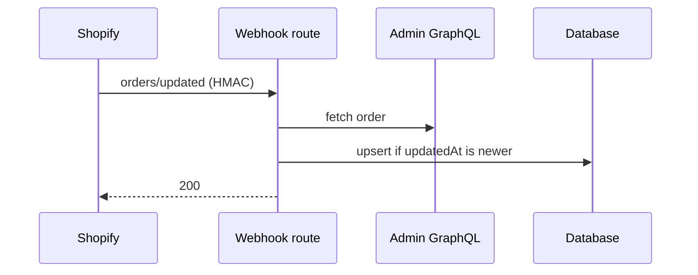

# Contributing

This repository is developed issue-first with TDD. The reasoning is in [ADR-0006](docs/adr/0006-tdd.md).

## 1. Branch from an issue

```bash
git switch -c issue-3-add-tag
```

Branch names follow `issue-{number}-{short-description}`. One branch handles one issue.

## 2. Check the test list

The issue's "Test list" defines the order of work. If something is missing, add it to the issue first.
Test names follow "Test naming" in [docs/requirements.md](docs/requirements.md).

## 3. Outer loop, then Red → Green → Refactor

### Outer loop: one acceptance test per issue

Start the issue by writing the route-level test from its test list that states the acceptance criterion
(e.g. "a signed `orders/create` webhook stores the order"). Commit it red. It stays red while you work
through the inner loop, and goes green when the issue is done.

### Inner loop: one test-list line at a time

| Stage | What to do | Commit |
|---|---|---|
| Red | Write one failing test and **confirm it fails for the expected reason** | `test: trim surrounding whitespace from tags (#3)` |
| Green | Write the minimum code to make it pass | `feat: trim surrounding whitespace from tags (#3)` |
| Refactor | Clean up while the tests stay green. Skip if nothing to do | `refactor: simplify normalizeTag branches (#3)` |

- Commit types: `test` / `feat` / `fix` / `refactor` / `docs` / `chore`
- End each message with the issue number
- Red commits only live on the working branch. Only fully green code reaches `main`

### How each layer is tested

| Target | How |
|---|---|
| `app/lib/domain/` (pure functions) | Inputs and outputs only. No mocks |
| `app/lib/repositories/` (database) | Real reads and writes against a test SQLite database. Prisma is not mocked |
| Routes (webhooks, loaders, actions) | Run with `SHOPIFY_TESTING` set so `shopifyApp()` uses `testConfig()`. Sign webhook requests with the test secret so `authenticate.webhook` runs for real. Replace only `admin.graphql`, using fixtures |
| GraphQL queries | Tag queries with `#graphql` and run `npm run graphql-codegen`; a wrong field fails the type check |
| UI (Polaris Web Components) | Keep components presentational. Thin jsdom tests that assert what is rendered (text, attributes), not Polaris behaviour; role-based queries are not expected to work. Approach confirmed in Step 1 (ADR-0006) |
| Configuration and the real store | Not tested. First check a route with `shopify app webhook trigger`, then confirm with real actions in the development store. Document the steps in the README |

### When the shape of external data is unknown (spike)

Do not write tests against data whose shape you have not seen, such as GraphQL responses.

1. Call the API with throwaway code to see the real shape (do not commit this code)
2. Save the response under `test/fixtures/` (replace names and addresses with test values)
3. Start TDD with the fixture as input. The query that produced it is typed by `graphql-codegen`, so the fixture and the types describe the same shape

## 4. Open a pull request

- Fill in every item of the PR template
- Put `Closes #n` in the description
- Explain **why**, not only what: for a decision PR, state what was verified and how the decision was made
- Merge with **Create a merge commit**. Squash and rebase merges are disabled because they would erase the TDD commits
- Get a review as described in [REVIEW.md](REVIEW.md): by an agent that did not write the code, with one fix-and-verify round
- If the PR touches an area in [SECURITY_REVIEW.md](SECURITY_REVIEW.md) §1, also get a security review

### Testing, Risks and Rollback

| Section | Write | Not enough |
|---|---|---|
| **Testing** | Who ran what, and the result: `npm test → 42 passed`, `webhook trigger → order stored (checked in Prisma Studio)` | "Tested locally", "should work" |
| **Risks** | What could break after merging, and the check that would catch it: "stale `orders/updated` overwrites newer data → `BE-1 … 2. ignores a stale webhook`" | A risk with no check, unless it says "no check yet" |
| **Rollback** | How to disable or undo it, and what a revert does **not** undo | "Revert the PR" when a migration or Shopify-side change is involved |

Rollback notes:

- PRs are merge commits, so a revert needs the parent: `git revert -m 1 <merge commit>`, then open a PR for the revert
- A revert does not undo a database migration that already ran, data already written, or changes on the Shopify side (order tags written with `tagsAdd`, webhook subscriptions, granted scopes). Say how to handle each one the PR introduces
- For documentation-only PRs, "revert the merge commit" is enough

## 5. Diagrams in pull requests

A diagram is **required** in the PR description when the change matches any row below. Otherwise it is optional.

| The change… | Diagram | Example in this app |
|---|---|---|
| Adds or changes a flow that spans three or more modules or layers | UML sequence diagram | Webhook → GraphQL refetch → upsert |
| Adds or changes state transitions, or depends on the order of events | UML state diagram | Tag edits racing with `orders/updated` |
| Adds or changes database models or their relations | ER diagram (or UML class diagram) | `Order` / `LineItem` / `Product` |

- Write diagrams in [Mermaid](https://mermaid.js.org/) inside the PR description. GitHub renders them, and they stay diffable as text
- Draw only what the PR changes or relies on, not the whole system
- If the diagram stays true after the PR is merged (e.g. the ER diagram), also put it in the README or the related ADR

Example:

````markdown

````
