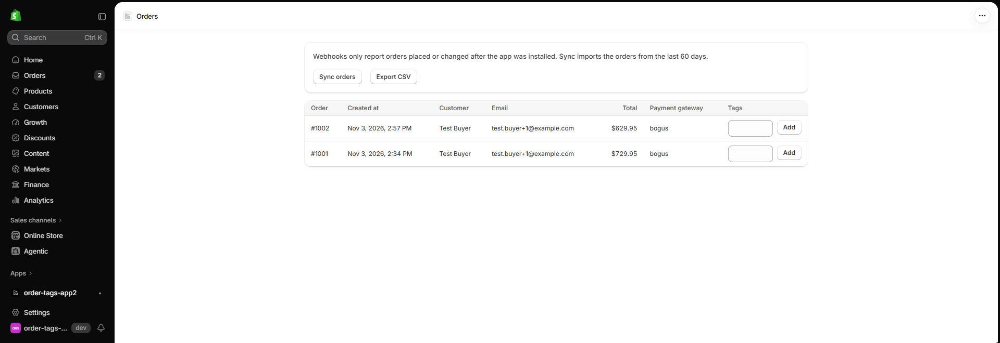
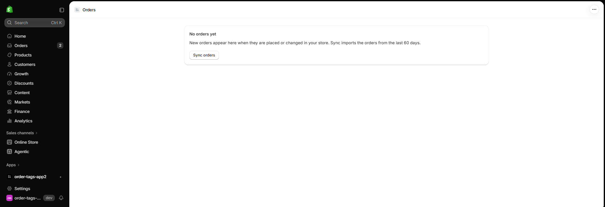
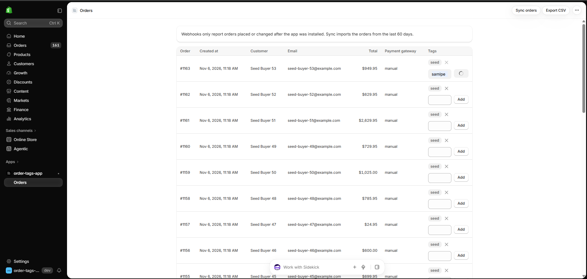
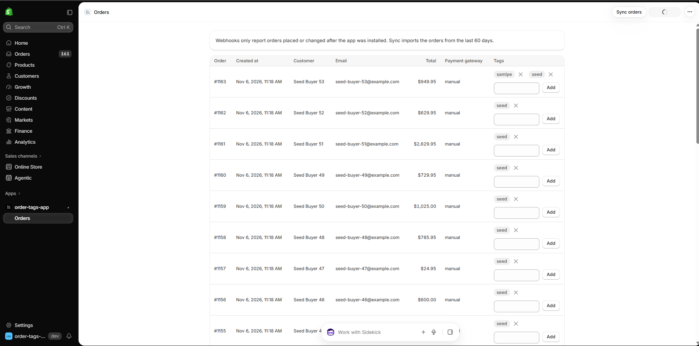
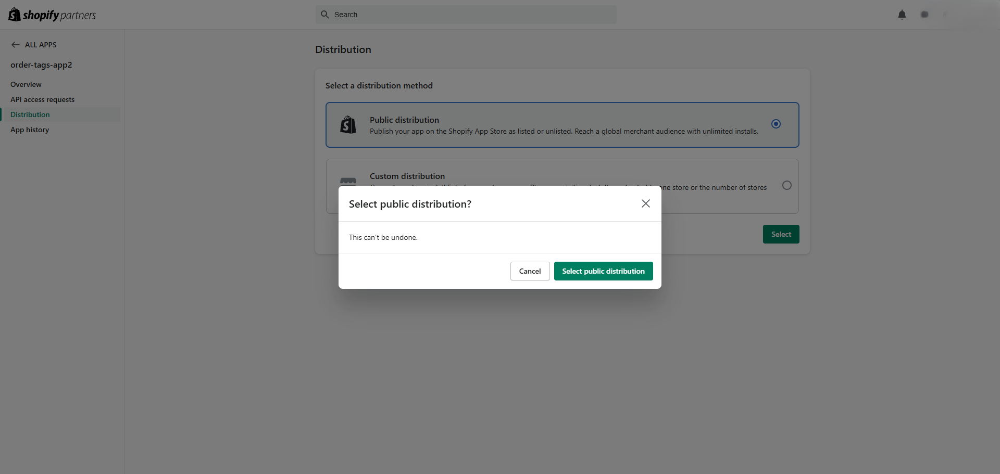
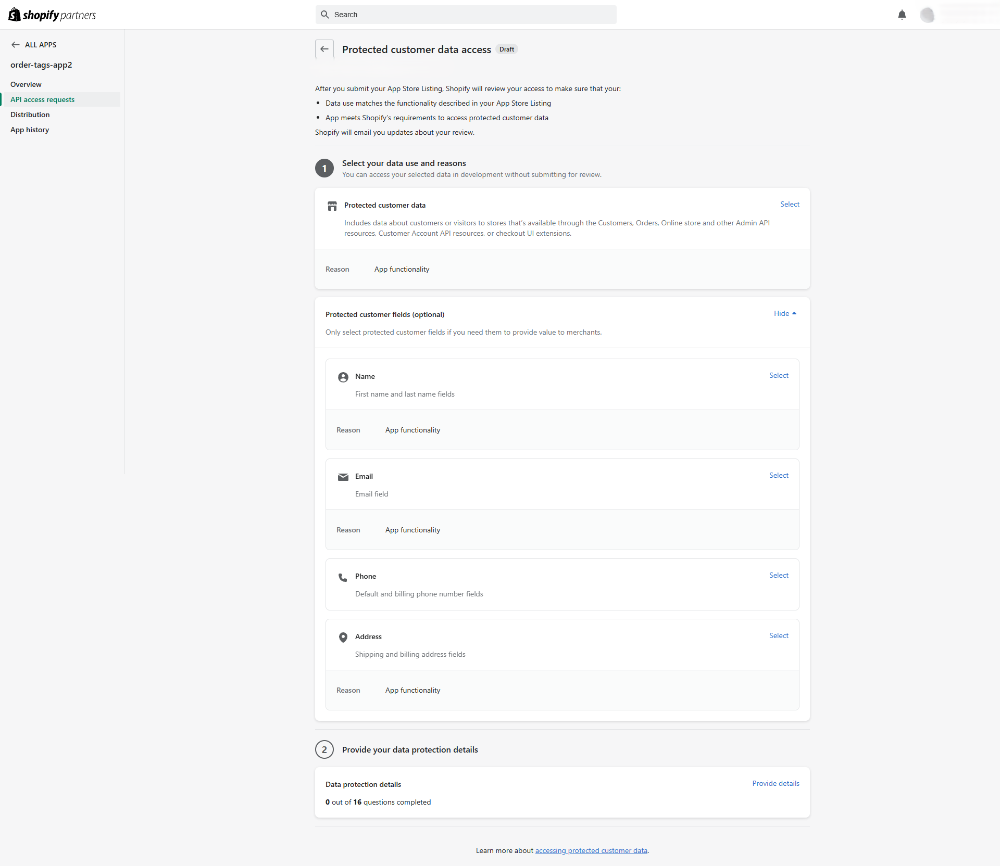
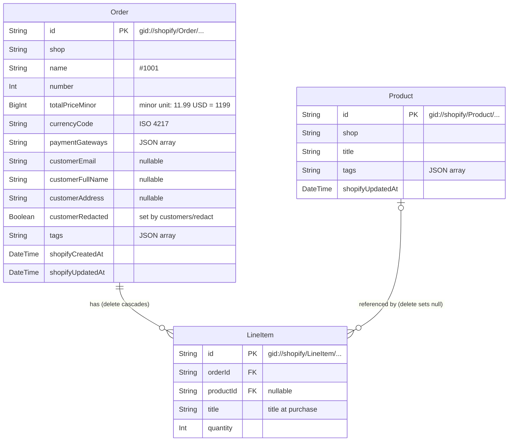

# Shopify Order Tags

[English](README.md) | 日本語

> これは [README.md](README.md) の翻訳です。内容が異なる場合は英語版を優先してください。

Webhook で注文を取り込み、マーチャントが注文タグを追加・削除でき、注文を CSV にエクスポートできる Shopify アプリです。

## 目次

- [機能](#機能)
- [レビュアー向けガイド](#レビュアー向けガイド)
- [スクリーンショット](#スクリーンショット)
- [インストールと設定](#インストールと設定)
- [データベース設計](#データベース設計)
- [課題の解釈](#課題の解釈)
- [実装上の選択](#実装上の選択)
- [開発プロセス](#開発プロセス)
- [既知の制限事項 / 本番環境での考慮事項](#既知の制限事項--本番環境での考慮事項)

## 機能

このアプリは Shopify 管理画面に埋め込まれており、ホームページは注文一覧です。

- **注文の取り込み:** `orders/create` と `orders/updated` の Webhook により、各注文とその明細、商品のコピーをアプリのデータベースに保持します
- **既存の注文のインポート:** **Sync orders** は、過去 60 日間の注文のうち、未保存のものと変更があったものをインポートします
- **注文一覧:** 注文を新しい順に 1 ページ 50 件で表示します。番号、日付、顧客、メールアドレス、合計金額、決済ゲートウェイ、タグを表示します
- **注文タグ:** マーチャントは注文の行からタグを追加し、タグの隣のボタンで削除できます。タグは Shopify に書き込まれるので、Shopify 管理画面にも表示されます
- **CSV エクスポート:** **Export CSV** は、ショップの全注文を明細ごとに 1 行でダウンロードします。各商品のタイトルとタグも含みます。[`samples/orders.csv`](samples/orders.csv) がサンプルです
- **顧客データ:** Shopify のコンプライアンス Webhook を処理し、アプリがアンインストールされるとショップのデータを削除します([顧客データ](#顧客データ)を参照)

## レビュアー向けガイド

[docs/requirements.md](docs/requirements.md) の各要件について、読み始める場所を示します。主なコード、テストファイル 1 つ、その背景にある判断です。

| 要件 | 実装 | テスト | 判断 |
|---|---|---|---|
| BE-1 Webhook による注文の作成・更新 | `app/routes/webhooks.orders.tsx`, `app/lib/ingest-order.server.ts` | `BE-1 Webhook ingestion`: `test/routes/webhooks.orders.test.ts` | [ADR-0003](docs/adr/0003-refetch-order-via-graphql.md), [ADR-0005](docs/adr/0005-process-webhooks-synchronously.md) |
| BE-2 注文一覧 | `app/routes/app._index.tsx`, `app/components/order-table.tsx` | `BE-2 Order list`: `test/routes/app._index.test.ts` | [ADR-0002](docs/adr/0002-polaris-web-components.md), [注文一覧の列](#注文一覧の列) |
| BE-3 タグの追加 | `app/routes/app.tags.tsx`, `app/lib/tag-order.server.ts` | `BE-3 Add tag`: `test/routes/app.tags.test.ts` | [ADR-0004](docs/adr/0004-sync-tags-to-shopify.md), [注文タグ](#注文タグ) |
| BE-4 タグの削除 | `app/routes/app.tags.tsx`, `app/lib/tag-order.server.ts` | `BE-4 Remove tag`: `test/routes/app.tags.test.ts` | [ADR-0004](docs/adr/0004-sync-tags-to-shopify.md), [注文タグ](#注文タグ) |
| BE-5 CSV エクスポート | `app/routes/app.export.tsx`, `app/lib/domain/orders-csv.ts` | `BE-5 CSV export`: `test/domain/orders-csv.test.ts` | [CSV の行](#csv-の行-明細ごとに-1-行), [CSV の形式](#csv-の形式) |
| BE-6 注文 JSON にないフィールド | `app/lib/shopify/order-query.ts`, `app/lib/domain/order-mapper.ts` | `BE-6 Fields not in order JSON`: `test/repositories/order-repository.test.ts` | [ADR-0003](docs/adr/0003-refetch-order-via-graphql.md), [商品タイトル](#商品タイトル-商品自体のタイトルを優先), [商品タグ](#商品タグ-その商品を含む注文と一緒に取得した値) |
| SUB-1 定期的なコミット | コミット履歴 | なし(文書) | [ADR-0006](docs/adr/0006-tdd.md), [コミット履歴の読み方](#コミット履歴の読み方) |
| SUB-2 データベース設計 | `prisma/schema.prisma` | `BE-7 Whole app : 3`: `test/database/schema.test.ts` | [データベース設計](#データベース設計) |
| SUB-3 スクリーンショット | `docs/images/features/` | なし(文書) | [スクリーンショット](#スクリーンショット) |
| SUB-4 サンプル CSV | `samples/orders.csv` | `BE-5 CSV export : 1`: `test/domain/orders-csv-sample.test.ts` | [CSV の形式](#csv-の形式) |
| SUB-5 インストールと設定 | `shopify.app.toml`, `shopify.web.toml` | なし(文書) | [インストールと設定](#インストールと設定) |
| SUB-6 実装上の選択 | `docs/adr/README.md` | なし(文書) | [実装上の選択](#実装上の選択) |

テスト名は表の接頭辞で始まります([テストの命名](docs/requirements.md#test-naming))。そのため `npx vitest run -t "BE-3 Add tag"` で、要件のテストを全ファイルにわたって実行できます。表にないものとして、既存の注文の同期(`app/routes/app.sync.tsx`、`BE-1 Webhook ingestion : 3`)と、アプリのライフサイクルおよびコンプライアンス Webhook(`BE-7 Whole app : 1`、[顧客データ](#顧客データ))があります。

## スクリーンショット

### 注文一覧



### 空の状態



### タグの編集



### CSV のダウンロード



## インストールと設定

Shopify 管理画面の表示名は、英語で表示されるとおりに記載しています。画面が変わっている場合は、リンク先の Shopify ドキュメントに最新の手順があります。

### 前提条件

- Node.js **24.22.1**(`.nvmrc` で固定。nvm を使う場合は `nvm use` を実行)。`package.json` では `>=22.12` も宣言しており、`.npmrc` により `npm` は古いバージョンを拒否しますが、ビルドとテストに使ったのは 24.22.1 です
- 組織を持つ Shopify パートナーアカウント([partners.shopify.com](https://partners.shopify.com))。組織がないと、Shopify CLI は "No Organization found" で停止します

Shopify CLI はプロジェクトの依存関係(`dependencies` の `@shopify/cli`)なので、グローバルインストールは不要です。npm スクリプトか `npx shopify` で実行します。

### 1. 依存関係をインストールして自分のアプリに接続する

```bash
nvm use               # Node.js version from .nvmrc
npm ci                # install exactly the versions in package-lock.json
npm run config:link   # create or select an app in your own organization
```

`shopify.app.toml` には作者の `client_id` が入っています。このファイルがあるため、`config:link` は設定名を尋ね、自分のアプリ用に `shopify.app.{name}.toml` を作成します。これが `npm run dev` のデフォルトになります。[Manage app config files](https://shopify.dev/docs/apps/build/cli-for-apps/manage-app-config-files) を参照してください。

新しいファイルの内容は Shopify 上の自分のアプリから取り込まれるので、このアプリに必要なものがすべて揃うわけではありません。新規作成したアプリの場合、スコープはありますが、Webhook のサブスクリプションはなく、`api_version` も異なります。`shopify.app.toml` の `[access_scopes]` と `[webhooks]` のセクションをこのファイルにコピーし、既存のセクションを置き換えてください。

### 2. 配布方法を選ぶ

Dev Dashboard で自分のアプリを開き、Home の **Distribution** カードを使います。Partner Dashboard のアプリの **Distribution** ページが開きます。**Public distribution** を選んで **Select** をクリックし、**Select public distribution** で確定します。Shopify では、保護された顧客データを申請する前に配布方法を選ぶ必要があります。[Select a distribution method](https://shopify.dev/docs/apps/launch/distribution/select-distribution-method) を参照してください。

この選択は後から変更できません。Shopify のドキュメントには、公開配布には Shopify App Store への登録も必要で、1 回限りの料金がかかるとあります([About app distribution](https://shopify.dev/docs/apps/launch/distribution))。このアプリに掲載は不要で、料金を一度も支払っていないアカウントでも、公開配布の選択と開発ストアでの実行のどちらでも、登録や料金は求められませんでした(#91)。



### 3. 保護された顧客データへのアクセスを許可する

注文の Webhook と CSV エクスポートには、顧客の氏名、メールアドレス、住所が必要です。[Work with protected customer data](https://shopify.dev/docs/apps/launch/protected-customer-data) を参照してください。

1. **Partner Dashboard**(Dev Dashboard ではありません)で **Apps** を開き、Dev Dashboard アプリの一覧から自分のアプリを開いて、**API access requests** → **Protected customer data access** に進みます
2. **Protected customer data** と、フィールド **Name**、**Email**、**Address** を選択し、理由に "App functionality" を選びます
3. 保存します。Step 2(データ保護の詳細)は App Store の審査でのみ必要で、開発ストアでは不要です



### 4. 開発ストアでアプリを実行する

```bash
npm run dev
```

尋ねられたら新しい開発ストアを作成し(プランは何でも構いませんが **Basic** を推奨します。**demo data** を使うと最初から商品と注文が入ります)、プレビュー URL を開いてアプリをインストールします。[Scaffold an app](https://shopify.dev/docs/apps/build/scaffold-app)(ステップ 3 と 4)と [Test apps locally](https://shopify.dev/docs/apps/build/cli-for-apps/test-apps-locally) を参照してください。

`npm run dev` は、ステップ 1 でコピーしたセクションのスコープ(`read_customers`、`read_orders`、`read_products`、`write_orders`)と Webhook のサブスクリプションを適用します。他の設定は不要です。

`npm run dev` の実行中は、dev プレビューがストアのアプリを自分のマシンに向けます。アプリをアンインストールするとプレビューは削除されます。再度インストールするには、Dev Dashboard の自分のアプリの **Installs** カードにある **Install app** を使い、`npm run dev` を再起動します。再起動しないと、アプリはプレースホルダーの `https://example.com` を開きます。

データベースの設定も不要です。`npm run dev` は `prisma generate` と `prisma migrate deploy` を実行します(`shopify.web.toml`)。初回の実行で `prisma/dev.sqlite` が作成され、以降は新しいマイグレーションが適用されます。`.env` ファイルは不要です。

### 5. テスト注文を作成する

**demo data** で作成したストアでは、Shopify のテスト決済ゲートウェイが有効になっています([Generated test data](https://shopify.dev/docs/apps/build/stores/generated-test-data)。そこでは Bogus payment gateway と呼ばれています)。これで支払った注文のゲートウェイは `bogus` と表示されます。チェックアウトに表示されない場合は、**Settings** → **Payments** で有効にします([Shopify's Test payment gateway](https://help.shopify.com/en/manual/checkout-settings/test-orders/payments-test-mode))。

1. Shopify 管理画面からオンラインストアを開きます(**Sales channels** → **Online Store** → 目のアイコン)。ストアのパスワードは **Online Store** → **Preferences** にあります([Dev stores](https://shopify.dev/docs/storefronts/themes/tools/development-stores))
2. 商品をカートに入れ、テストデータでチェックアウトします。例: メールアドレス `test.buyer+1@example.com`、米国の住所
3. カード番号 `1`、任意の将来の有効期限、任意の 3 桁のセキュリティコード、カード名義 `Test payment gateway` で支払います

`npm run dev` の実行中は `orders/create` Webhook が注文を保存し、ページを再読み込みするとアプリのホームの注文一覧に表示されます。Shopify 管理画面で注文を編集する(たとえばタグを追加する)と `orders/updated` が送信され、保存済みのコピーが更新されます。保存された行を見るには、`npx prisma studio` で開発データベースを開きます(テーブル `Order`、`LineItem`、`Product`)。

### 6. 既存の注文を取り込む

Webhook が通知するのは、アプリのインストール後に作成または変更された注文だけです。それ以前の注文を取り込むには、アプリを開いてアプリのホームで **Sync orders** をクリックします。同期の実行中はボタンが無効になり、終わるとインポートした注文の数が表示されます。同期は注文を `updatedAt` とともに一覧し、未保存のものと保存後に変更されたものだけを取得します。それぞれ Webhook と同じ再取得と書き込みを通ります([ADR-0003](docs/adr/0003-refetch-order-via-graphql.md))。そのため、何も変わっていなければ 2 回目の同期は `0` 件をインポートします。同期が途中で止まった場合は、止まるまでにインポートした注文の数がページに表示され、もう一度実行するとそこから続きます。

このアプリには `read_orders` があり `read_all_orders` がないので、Admin API が一覧するのは過去 60 日間に作成された注文だけで([access scopes](https://shopify.dev/docs/api/usage/access-scopes))、同期がインポートするのもそれらだけです。Partner 組織で作成したアプリが `read_all_orders` を使うには Shopify の承認が必要です(#21)。

### 7. テストを実行する

```bash
npm test             # all tests once
npm run test:watch   # re-run on change
npm run typecheck    # regenerates GraphQL types, then runs tsc
```

テストに Partner アカウント、ストア、`.env` ファイルは不要です。実行のたびに別のデータベース `prisma/test.sqlite` を `prisma/migrations/` から作り直すので、`prisma/dev.sqlite` には触れません。Shopify の Admin API は、開発ストアから取得したレスポンス(`test/fixtures/`)に置き換えています。各レイヤーのテスト方法の詳細は [CONTRIBUTING.md](CONTRIBUTING.md#how-each-layer-is-tested) にあります。

## データベース設計

データベースは SQLite で、Prisma で管理しています(`prisma/schema.prisma`)。注文、明細、商品は Shopify のデータのコピーです。データの所有者は Shopify です([ADR-0004](docs/adr/0004-sync-tags-to-shopify.md))。コピーへの書き込みは次の 4 通りです。

- **取り込み:** `orders/create` または `orders/updated` の Webhook、または既存の注文の同期([ステップ 6](#6-既存の注文を取り込む))が、Admin API から注文を再取得し、注文とその明細、商品を書き込みます。注文と明細は、Shopify の `updatedAt` が保存済みの `shopifyUpdatedAt` より古い場合を除いて書き込みます(同じ値は書き込みます。`updatedAt` の精度は 1 秒なので、同じ秒の後の変更を含む可能性があるためです)。これは同じ注文の取得が同時に 2 つ走る場合への対策です([ADR-0003](docs/adr/0003-refetch-order-via-graphql.md))。各商品も同様に、商品自体の `updatedAt` が保存済みの `shopifyUpdatedAt` より古い場合を除いて書き込みます。同じ商品を含む 2 つの注文が同時に取り込まれる可能性があるためです(#6)
- **タグの編集:** アプリで注文タグを追加または削除すると、先に Shopify に書き込み、次にデータベースに書き込みます([ADR-0004](docs/adr/0004-sync-tags-to-shopify.md))
- **コンプライアンス Webhook:** `customers/redact` は注文の顧客フィールドを空にし、`shop/redact` はアンインストールされたショップのデータを削除します([顧客データ](#顧客データ)を参照)
- **削除:** このアプリは Shopify の削除 Webhook(`orders/delete`、`products/delete`)をサブスクライブしていないので、Shopify での削除は受信しません([設計上の選択](#設計上の選択)の「削除時の動作」を参照)



### テーブル

| テーブル | 保持するもの | 備考 |
|---|---|---|
| `Order` | Shopify の注文ごとに 1 行。ショップ単位 | `customerAddress` は書式を整えた 1 つの文字列です(配送先。なければ請求先)。`customers/redact` は `customerEmail`、`customerFullName`、`customerAddress` を null にし、`customerRedacted` を true にします。以降の取り込みでも 3 つのフィールドは null のままです([顧客データ](#顧客データ)を参照) |
| `LineItem` | 注文の明細ごとに 1 行 | その注文を最後に取り込んだときに明細に商品がなければ、`productId` は null です。カスタム明細や、Shopify で削除済みの商品の場合です |
| `Product` | 取り込んだ注文に現れた商品ごとに 1 行。ショップ単位 | その商品を含む注文と一緒に取得したタイトルとタグで、そのような注文を取り込むたびに書き込みます。`shopifyUpdatedAt` は Shopify での商品の `updatedAt` なので、そのような取り込みが同時に 2 つ走っても、古い取得で新しい値を上書きしません。`app/uninstalled` と `shop/redact` はショップの商品を削除します |
| `Session` | アプリテンプレート由来の Shopify OAuth セッション | テンプレートから変更していません。他のテーブルと関係がないので、図には入れていません |

### 設計上の選択

**Shopify の GID を主キーにしています**(`gid://shopify/Order/...`、`.../LineItem/...`、`.../Product/...`)。

- Webhook が GID(`admin_graphql_api_id`)を運び、GraphQL の再取得([ADR-0003](docs/adr/0003-refetch-order-via-graphql.md))はそれをそのまま受け取ります
- 同じオブジェクトを 2 回 upsert しても同じ行に当たるので、Webhook が繰り返されても重複は作られません
- アプリの ID と Shopify の ID の対応付けが不要です

**`Product` は別テーブルです。** 商品は注文をまたいで多くの明細に共有され、CSV には明細が持つ値ではなく商品自体のタイトルとタグが必要です([課題の解釈](#課題の解釈)を参照)。商品ごとに 1 回だけ保存することで、その商品のすべての明細が同じ値を表示します。値は、商品自体が変わったときではなく、その商品を含む注文を取り込むたびに更新します。`LineItem.title` は、明細に商品がない場合の代替として購入時のタイトルを保持します。

**削除時の動作。** このアプリは `orders/create`、`orders/updated`、`app/uninstalled` と、コンプライアンス Webhook の `customers/data_request`、`customers/redact`、`shop/redact` をサブスクライブしています。どれも注文や商品の削除を通知しないので、Shopify で削除してもここの行は削除されません。`app/uninstalled` は、署名されたペイロードがそのショップを示す配信のたびに、ショップの注文、明細、商品、セッションを削除します([顧客データ](#顧客データ)を参照)。Shopify がアンインストールの 48 時間後に送る `shop/redact` は、ショップの注文、明細、商品を再び削除するので、`app/uninstalled` の後に書き込まれたものも削除されます。その 48 時間のうちにアプリが再インストールされていれば、`shop/redact` は何も削除しません。`customers/redact` が何を変更するかは[顧客データ](#顧客データ)にあります。

Shopify で削除された商品が反映されるのは、その後に再び取り込まれた注文だけです。削除された商品について、再取得は商品を返しません(`product: null`。#6 で取得したレスポンスで確認済み)。そのため `productId` は null になり、CSV は購入時のタイトルを使います。その商品を含む他の注文は、保存済みのタイトルとタグを表示し続けます。

外部キーは、アプリのデータベースで行を削除したときの動作を定義します。注文を削除すると、その明細も削除されます(`onDelete: Cascade`)。商品を削除しても明細は残り、`productId` が null になります(`onDelete: SetNull`)。そのため、注文と購入時のタイトルは CSV に残ります。`app/uninstalled` と `shop/redact` は、ショップの注文(明細も一緒に)と商品を削除します。

**タグと決済ゲートウェイは String 列の JSON 配列です。** 例: `["VIP","wholesale"]`。SQLite には配列型がありません。JSON なら、値にどんな文字が含まれていても曖昧になりません(カンマ区切りの文字列ではそうはいきません)。また、タグの追加と削除は配列の操作で済みます。現在の要件では、SQL でタグを絞り込む必要はありません。

**注文の合計金額は、通貨の最小単位の整数です**(`totalPriceMinor`: 11.99 USD → `1199`、1500 JPY → `1500`)。`currencyCode` とともに保存します。String 列は Prisma の `_sum` で合計できず、SQLite 上の Prisma の `Decimal` は浮動小数点の REAL として保存されるので、整数で持ちます。注文をまたぐ合計は通貨ごとに計算します。列は `BigInt` で、Prisma は JavaScript の `bigint` を返します。32 ビットの `Int` では 1 注文の上限が 2,147,483,647 最小単位(約 2,100 万 USD、KWD のような小数 3 桁の通貨では約 210 万)になり、それより大きな注文が 1 つあると、その行を返すすべてのクエリが失敗します。

**インデックス。** `Order(shop, shopifyCreatedAt)` は注文一覧(ショップの注文を新しい順に)に使います。SQLite は外部キーに自動でインデックスを張らないので、`LineItem(orderId)` と `LineItem(productId)` にインデックスを張っています。`Product(shop)` は外部キーのインデックスではなく(`shop` は普通の列です)、`app/uninstalled` と `shop/redact` でショップの商品を削除するために使います。

### 顧客データ

このアプリが保存する顧客フィールドは、`Order` の `customerEmail`、`customerFullName`、`customerAddress` の 3 つだけです。これらはマーチャント自身の Shopify の注文からコピーしたものです。他のテーブルに顧客データはなく、Shopify の顧客 ID も保存しません。

Shopify は、App Store への掲載の有無にかかわらず、すべての公開アプリに 3 つのコンプライアンス Webhook の処理を求めています。このアプリは `shopify.app.toml`(`compliance_topics`)でこれらをサブスクライブしています。各ルートは HMAC 署名を検証し、無効なら 401 を返します。ショップは `X-Shopify-Shop-Domain` ヘッダーから取得しますが、署名はこのヘッダーを対象にしていないので、2 つの redaction ルートは、署名されたペイロードの `shop_domain` が別のショップを示す場合にも 401 を返します。それ以外の場合、各ルートは次の処理をしてから 200 を返します。

| トピック | Shopify が送るタイミング | アプリの処理 |
|---|---|---|
| `customers/redact` | マーチャントが顧客データの削除を依頼してから 10 日後 | `orders_to_redact` に列挙された、そのショップの注文の顧客フィールド 3 つを null にし、`customerRedacted` を設定します。そのような注文を後で取り込んでも(たとえば返金後の `orders/updated`)、Shopify が何を返しても 3 つのフィールドは null のままです。注文、明細、タグは、Shopify と同様に残ります。列挙された注文のうち、アプリが保存していないものはスキップします |
| `shop/redact` | アプリのアンインストールから 48 時間後 | `app/uninstalled` と同様に、ショップの注文、明細、商品を削除します。ショップに再びセッションがある場合(その 48 時間のうちにアプリが再インストールされた場合)は何も削除しません。`app/uninstalled` がセッションを削除するので、データは新しいインストールのものになるためです。再インストールで `shop/redact` が取り消されるかどうかは、Shopify のドキュメントに書かれていません |
| `customers/data_request` | 顧客がマーチャントに自分のデータを求めたとき | トピックとショップをログに記録するだけです。顧客の詳細はログに残しません。アプリは顧客に何も送りません。保存しているフィールドはマーチャント自身の注文のコピーなので、マーチャントは Shopify 管理画面ですでに見られます。アプリの注文一覧は氏名とメールアドレスを表示し、CSV エクスポートは 3 つすべてを含みます |

注文は ID だけで照合します(`orders_to_redact`。数値 ID を GID に変換します)。アプリが顧客 ID を保存していないためです。このリストにない注文の顧客データは残ります。これらのルートにセッションは不要なので、redaction はアプリのアンインストール後も動きます。

`app/uninstalled` はコンプライアンス Webhook ではありませんが、同じデータを削除し、同じチェックがあります。署名されたペイロードの `myshopify_domain` がヘッダーのショップと一致しなければ、401 を返して何も削除しません。開発ストアから取得した実際の配信ではこのフィールドにショップのドメインが入っていますが、Shopify のドキュメントのサンプルでは null です。

ルートを手動で確認するには、アプリを実行し(`npm run dev`)、`npx shopify app webhook trigger --topic customers/data_request`(または `customers/redact`、`shop/redact`)で Shopify のサンプルペイロードを送ります。尋ねられたらアプリのローカルアドレスとクライアントシークレットを入力します。`customers/data_request` は 200 を返します。2 つの redaction ルートはサンプルに 401 を返します。`shop_domain` がプレースホルダーの `{shop}.myshopify.com` で、ヘッダーのショップと一致しないためです。redaction の処理自体はルートのテスト(`test/routes/webhooks.customers.redact.test.ts`、`test/routes/webhooks.shop.redact.test.ts`)でカバーしています。

`app/uninstalled` も `"myshopify_domain": null` を持つサンプルを拒否するので、`--topic app/uninstalled` で 401 になるのは想定どおりです。`npm run dev` は、アプリのクライアント ID が前回の実行と異なるとき(初回の実行と `config:link` の後の実行を含みます)、この種のサンプルを自動でルートに送ります。このとき CLI は `APP_UNINSTALLED webhook delivery failed` と表示し、ローカルのデータは残ります。

## 課題の解釈

課題には未確定の細部があります。このアプリは次の解釈に従っています(#18 で決定)。

### CSV の行: 明細ごとに 1 行

各行が 1 つの明細です。注文の列(注文 ID、番号、合計金額、顧客、タグなど)は、同じ注文のすべての行で繰り返します。数量 `0` の明細は、注文編集で削除されたか返金されたもので、行を出力しません。そのため、行は現在の注文の内容と一致します。

これにより、各行の商品タイトルと商品タグは 1 組になり、スプレッドシートで絞り込みやピボットができます。

> **注意:** 注文の列が繰り返されるので、全行の *Total price* を合計すると、注文が明細の数だけ重複して数えられます。注文ごとに重複を除いて合計してください。

### 商品タイトル: 商品自体のタイトルを優先

*Product title* は商品自体のタイトル(`Product.title`)で、下記の商品タグと同じ方法で取得・更新します。明細に商品がない場合(`productId` が null。[データベース設計](#データベース設計)の `LineItem` の行を参照)は、購入時に明細に記録されたタイトル(`LineItem.title`)を使います。

課題では、*Product title* を "not in order/id/.json" のフィールドに挙げています。注文には各明細の購入時のタイトルがすでにあるので、求められているのは商品自体のタイトルだと解釈しました。

### 商品タグ: その商品を含む注文と一緒に取得した値

商品タグは、注文を取り込むたび(`orders/create`、`orders/updated`、同期)に注文と一緒に取得し、商品ごとに 1 回保存します。同期が取り込むのは未保存の注文と保存後に変更された注文だけなので、変更のない注文の商品のタグは更新しません。その商品を含む注文を取り込むたびに、保存済みの商品のほうが新しい場合を除いて書き込みます([データベース設計](#データベース設計)の `Product` の行を参照)。そのため、その商品に紐づく明細はすべて、自身の注文を取り込んだ時点のタグではなく、同じ保存済みのタグを表示します。商品のない明細の *Product tags* は空です。タイトルと違い、購入時にタグは記録されないためです。アプリは商品の Webhook やイベントから商品を更新しないので、商品のタグの変更は、その商品を含む注文を次に取り込んだときに反映されます。Shopify で削除された商品は、再び取り込まれない注文では保存済みのタイトルとタグを保ちます。

### 顧客の住所: 配送先を優先

*Customer address* は注文の配送先住所です。配送先のない注文(たとえばデジタル商品)は請求先住所を使います。
Shopify の住所行(`formatted`、氏名なし)を `, ` でつなげます。例: `123 Test Street, San Francisco CA 94103, United States`。

### 顧客の氏名とメールアドレス

*Customer full name* は注文の顧客の姓名です。*Customer email* は注文のメールアドレスです。どちらも空の場合があります。たとえば、顧客を選ばずに管理画面で作成した注文です。顧客を読むには `read_customers` スコープが必要です(#1)。

### 合計金額と数量: 現在の値をショップの通貨で

*Total price* は、ショップの通貨での注文の現在の合計金額(`currentTotalPriceSet`)です。返金、返品、注文編集の後の値で、税と割引を含みます。明細の数量は現在の数量(`currentQuantity`)なので、注文編集で削除された明細は数量 `0` で残る想定です(API リファレンスから読み取ったもので、取得したレスポンスではまだ確認していません)。どちらも、Shopify 管理画面での現在の注文と一致します。#1 で決定しました。

### CSV の形式

| 項目 | 形式 |
|---|---|
| 列 | CSV テンプレートの 9 フィールドを順に並べ、その後に *Product title* と *Product tags* を続けます |
| Order id | 数値 ID です。例: `gid://shopify/Order/6663058751643` の `6663058751643`。`order/id.json` の `id` や、Shopify 管理画面の注文 URL にあるものです |
| Order number | ショップの接頭辞を除いた番号です。例: `#1006` の `1006` |
| Total price | ショップの通貨での素の 10 進数で、記号は付けません: `11.99`、`1500`(JPY)、`1.234`(KWD) |
| 1 セル内の複数の値(タグ、決済ゲートウェイ) | `, ` でつなげて引用符で囲みます |
| 日付 | UTC の ISO 8601 です。例: `2026-11-02T13:05:00Z`。ショップのタイムゾーンは保存しておらず、UTC はサーバーのタイムゾーンに依存しません |
| エンコーディング | BOM 付き UTF-8 です。Excel が非 ASCII の氏名や住所を正しく開けます |
| 改行 | CRLF(RFC 4180) |
| エスケープ | RFC 4180(`,`、`"`、改行を含む値は引用符で囲み、`"` は 2 つ重ねます)。`,` と `;` の両方を区切り文字として受け付けるリーダーのために、`;` を含む値も引用符で囲みます |
| 数式セル | テキストセル(決済ゲートウェイ、顧客フィールド、タグ、商品タイトル、商品タグ)が `=`、`+`、`-`、`@`、タブ、復帰、改行、全角の `＝`、`＋`、`－`、`＠` で始まる場合、先頭に `'` を付けます。スプレッドシートがそのようなセルを数式として実行する可能性があるためです([OWASP](https://owasp.org/www-community/attacks/CSV_Injection))。同じ文字がセル内の `;` や改行の後にある場合も、間に `"` があってもなくても `'` を付けます(`x;=1+1` は `x;'=1+1` になります)。`;` を区切り文字とするスプレッドシートでは、カンマで行が分割されず、値は `;` と改行ごとに切られ、引用符では防げないためです。カンマ区切りのマーチャントには、その `'` が値に見えます。数値列と生成列(注文 ID、注文番号、合計金額、作成日時)には付けないので、負の合計金額は数値のままです |

マーチャントは、注文一覧の上にある **Export CSV** ボタンでファイルをダウンロードします。ボタンはショップに注文があると表示されます。ファイルにはショップの全注文が新しい順に入り、1 つの注文の行の順序は安定しています。アプリのデータベースから作るので、エクスポートは Shopify API を呼びません。明細が残っていない注文にも、商品の列が空の行が 1 行出力されます。

[`samples/orders.csv`](samples/orders.csv) はファイルのサンプルです。注文は架空のテストデータで、ストアからダウンロードしたものではなく、エクスポートと同じコード(`buildOrdersCsv`)で書き出しています。カンマ、引用符、数式セルなどのケースをまとめて示すためです。`test/domain/orders-csv-sample.test.ts` がこれらの注文を持ち、ファイルがエクスポートの出力と一致しなくなると失敗します。

### 配布方法: 公開

このアプリは公開配布を使うので、どのストアにもインストールできます。Shopify App Store には掲載していません。

### 注文一覧の列

注文番号、作成日時、顧客、メールアドレス、合計金額、決済ゲートウェイ、タグです。これらは注文を一目で見分けるのに必要な CSV のフィールドで、すべてのフィールドは CSV にあります。

注文はアプリのデータベースから新しい順に 1 ページ 50 件で表示するので、ページの表示で Shopify API は呼びません。*Created at* はブラウザのタイムゾーンで表示します。アプリはショップのタイムゾーンを保存していないので、タイムゾーンが異なると Shopify 管理画面の表示と違う場合があります。*Total* は注文に保存された通貨で、英語の書式で表示します(`$11.99`、`¥1,500`)。

### 注文タグ

マーチャントは一覧の注文の行からタグを追加します。タグは Shopify に送る前にチェックします。

| 入力 | 結果 | 理由 |
|---|---|---|
| 前後の空白 | 取り除く | |
| 空 | 拒否 | |
| カンマを含む | 拒否 | `tagsAdd` は `a,b` を 2 つのタグに分割します |
| 55 文字超 | 拒否 | Shopify は 56 文字から `Order tags is invalid` を返します。絵文字は 1 文字と数えます |
| 大文字小文字を問わず、注文がすでに持っている | 拒否 | `tagsAdd` は `vip` を既存の `VIP` として扱い、何もしません |

この上限と上記の動作は開発ストアで測定したものです(Admin API 2026-10、#3)。ドキュメントには書かれていません。チェックには保存済みのタグのコピーを使うので、Shopify より遅れている場合があります。Shopify 管理画面で直前に追加されたタグは検出できない場合があり、そのとき `tagsAdd` はそのタグに対して何もしません。保存済みのコピーで見つかった重複は、注文を再取得して再度チェックするので、Shopify 管理画面で直前に削除されたタグは追加し直せます。

マーチャントは、タグの隣のボタンでタグを削除します。タグは保存されているとおりに送ります。`tagsRemove` は大文字小文字を区別して照合し、見つからないタグはエラーなしで無視するためです。上記のチェックは通らないので、他の場所で追加された、チェックでは拒否されるようなタグも削除できます。レスポンスに大文字小文字を問わずそのタグがまだあれば、マーチャントにエラーを表示し、注文を保存し直します。こうすると、次の試行では Shopify にあるとおりのタグを使います。

タグの編集後、アプリは注文を再取得し、Webhook と同じ方法で注文全体を保存します([ADR-0003](docs/adr/0003-refetch-order-via-graphql.md))。そのため、保存された `updatedAt` は常に注文のすべての列を表します。また、Shopify で何も変わらず `orders/updated` が送られない編集でも、コピーは最新になります。編集前の Webhook の取得は古いので、遅れて終わってもスキップされます。再取得が失敗しても、編集は Shopify に届いているので、マーチャントには成功と伝えます。その `orders/updated` がコピーを修復します。

## 実装上の選択

設計上の判断は Architecture Decision Record として [docs/adr/](docs/adr/README.md) に記録しています。各 ADR に検討した選択肢と理由の全体があります。この表はその要約です。

| ADR | 判断 | 理由 |
|---|---|---|
| [0001](docs/adr/0001-react-router-template.md) | React Router v7 のアプリテンプレートをベースにする | 課題は Node.js または Remix を推奨しています。React Router v7 は Remix の後継で Shopify の現行テンプレートであり、Remix パッケージには重大なセキュリティ修正しか提供されません |
| [0002](docs/adr/0002-polaris-web-components.md) | UI を Polaris Web Components で作る | Polaris React にはもう更新がなく、テンプレートがすでに Web Components を使っています |
| [0003](docs/adr/0003-refetch-order-via-graphql.md) | Webhook をトリガーとして使い、各注文を GraphQL で再取得する | Webhook のペイロードには商品タグがないので、いずれにせよ取得が必要です。注文全体を再取得すれば、データソースとマッピングが 1 つで済みます |
| [0004](docs/adr/0004-sync-tags-to-shopify.md) | 注文タグをアプリのデータベースだけでなく Shopify にも書き込む | データの所有者は Shopify です。アプリにだけ保存したタグは、次に注文を再取得したときに消えます |
| [0005](docs/adr/0005-process-webhooks-synchronously.md) | Webhook をキューではなくリクエスト内で処理する | 1 回の配信にかかるのは約 0.5 秒で、Shopify の上限は 5 秒です。レビュアーはワーカーや Redis なしでアプリを実行できます。本番環境ではキューを使います |
| [0006](docs/adr/0006-tdd.md) | TDD で開発し、プルリクエストをマージコミットでマージする | 中心のロジックはテストファーストにしやすく、コミットが作業の過程を示します。UI のテストは薄く、Shopify の設定は手動で確認します |

## 開発プロセス

要件、その Issue、テストの命名は [docs/requirements.md](docs/requirements.md) にあります。ルールは 3 つの文書にあります。

- **Issue ファーストの TDD([CONTRIBUTING.md](CONTRIBUTING.md)):** 変更はテストリスト付きの Issue から始めます。専用のブランチでテストファーストで作り、実行したこと、リスク、ロールバックの方法を記録したプルリクエストを通して `main` に入れます
- **コードレビュー([REVIEW.md](REVIEW.md)):** プルリクエストは、コードを書いていないエージェントがレビューし、修正と検証は 1 ラウンドです。マージは作者が判断します
- **セキュリティレビュー([SECURITY_REVIEW.md](SECURITY_REVIEW.md)):** プルリクエストが認証、Webhook、顧客データ、Shopify への書き込み、スコープ、エクスポート、依存関係に触れる場合に必要です

### コミット履歴の読み方

プルリクエストはマージコミットでマージし、squash と rebase のマージは無効にしているので、各変更のコミットが履歴に残ります。

```bash
git log --first-parent --oneline main                       # one merge per pull request, after the first setup commits
git log --no-merges --oneline --reverse --grep='(#3)' main  # the commits of one issue, oldest first
```

Issue の中では、`test:` コミットが失敗するテストを追加し、`feat:` または `fix:` コミットがそれを通し、`refactor:` コミットが整理します。各メッセージの末尾は Issue 番号です。ブランチ内のコミットではテストが失敗することがあるので、テストが通ることを期待できるのは `main` のマージコミットだけです。
既知の例外は [PR #90](https://github.com/rukiita/shopify_test/pull/90) の "Commit history" に列挙しています。最初のプルリクエストより前のセットアップコミットと、既存の動作を記述する #90 自体の `test:` コミットも、このパターンの対象外です。

## 既知の制限事項 / 本番環境での考慮事項

### スコープの判断

- このアプリは Shopify App Store に提出していません。Shopify が求めるコンプライアンス Webhook は実装していますが([顧客データ](#顧客データ)を参照)、保護された顧客データの申請の Step 2(データ保護の詳細)と App Store の審査は済んでいません
- リポジトリには Dockerfile などのデプロイ設定がありません。アプリは `npm run dev` でローカルで実行します
- CI はありません。リポジトリに GitHub Actions のワークフローはなく、テスト、コードレビュー、セキュリティレビューはローカルで実行します
- CSV エクスポートは、1 つのリクエスト内でショップの全注文を読み、メモリ上でファイルを作ります。大規模なストアでは測定していません。読み込みは 1 つの SQLite 接続を共有し、ファイルの生成は Node プロセスを占有するので、その間すべてのショップの注文 Webhook が待たされ、Shopify の 5 秒の上限を超えて Shopify の再試行に任せることになる場合があります。大規模なストアでは、行をストリーミングするか、バックグラウンドジョブでファイルを作ってください(#5)
- 保存するのは注文の最初の 250 明細だけです(GraphQL の 1 ページ、`lineItems(first: 250)`)。それを超える明細は保存されず、CSV にも入りません(#1)
- 注文の Webhook はリクエスト内で処理します。アプリは応答の前に注文を取得して保存します([ADR-0005](docs/adr/0005-process-webhooks-synchronously.md))。1 回の配信にかかるのは約 0.5 秒で、Shopify の上限は 5 秒です。データベースへの書き込みは 1 つの SQLite 接続で 1 つずつ実行するので、同時に届いた配信は互いを待ちます(#77)。大きな注文で約 75 件、小さな注文で約 170 件を超える同時の集中(データベースへの書き込みだけで測定した値で、ルートを通すともっと少ない可能性があります)は一部が失敗し、Shopify の再試行に任せます。本番環境では、Webhook をキューから処理し、同時書き込みができるデータベースを使い、配信が失われた注文を突き合わせてください。突き合わせのジョブは予定していません。同期([ステップ 6](#6-既存の注文を取り込む))を手動で実行でき、過去 60 日間の注文のうち、欠けているものと変更があったものをインポートします
- `customers/data_request` はリクエストをログに記録するだけです。Shopify は、アプリが要求されたデータを 30 日以内にストアオーナーへ直接提供するよう求めています([privacy law compliance](https://shopify.dev/docs/apps/build/compliance/privacy-law-compliance))。本番環境では、その期間内に保存データをストアオーナーへ提供してください(#98)
- アクセストークンと顧客データは SQLite に暗号化せずに保存しています(`Session`、`Order`)。このアプリは氏名、メールアドレス、住所を使うので、Shopify の保護された顧客データの要件でレベル 2 に該当し、その要件には保存データの暗号化が含まれます([protected customer data](https://shopify.dev/docs/apps/launch/protected-customer-data))。本番環境では保存時に暗号化してください(#98)
- 既存の注文の同期は、1 つのリクエスト内で 1 注文ずつ実行します。注文を 1 ページ 250 件で一覧し、新規または変更のある注文を Webhook と同じように取得して書き込みます。時間はインポートする注文の数に比例して増えます(同じ取得と書き込みは Webhook の配信 1 回あたり約 0.5 秒です。同期自体は大規模なストアで測定していません)。Shopify が 429 または 503 で応答したリクエストは 3 回まで試行します。GraphQL のレート制限はステータス 200 の `THROTTLED` エラーとして報告され、これは再試行しません。同期は止まり、それまでにインポートした注文は残り、もう一度実行すると未インポートの注文から続きます。複数の注文を同時に取得することはしていません(#70)。大規模なストアでは、バルクオペレーションを使ったバックグラウンドジョブで実行してください(#21)

### 既知の問題

- `read_customers` は最初のインストールの後に追加しました(#1)。それ以前にインストールしたストアでは、マーチャントがアプリを開いて新しいスコープを承認するまで、このスコープがありません。それまでは注文のクエリが拒否され、そのストアの注文 Webhook は失敗して再試行されます
- CSV に通貨の列はありません。*Total price* は注文を最後に取り込んだときのショップの通貨なので、ショップが通貨を変更すると、列に複数の通貨が混ざる場合があります(#5)
- *Order id* は 13 桁以上の素の数値です。Excel では指数表記で表示されると想定され、Excel からファイルを保存すると丸められた形で書き出される可能性があります(Excel ではまだ確認していません)。元のファイルを保管するか、列をテキストとしてインポートしてください(#5)
- `'` の接頭辞はファイルを開くときの数式の実行を防ぎますが、OWASP は、ファイルの保存と再度の読み込みの後に Excel が引用符やエスケープ文字を取り除く可能性があると警告しています(#5)
- `customers/redact` がマークするのは、アプリがすでに保存している注文だけです。`orders_to_redact` にある注文が後から保存された場合(たとえば既存の注文の同期で)、顧客フィールドはそのとき Shopify が返すとおりになります。`app/uninstalled` と `shop/redact` はショップの注文を削除し、`customerRedacted` も一緒に消えるので、再インストール後の同期で、redact された注文の顧客フィールドを Shopify が返せば保存される可能性があります(#65、#98)
- ショップのオフライントークンの有効期限が切れていると、`app/uninstalled` の配信は失敗し、ショップのデータは削除されません。`authenticate.webhook` は、ルートのコードが動く前に期限切れのトークンを更新します。開発ストアでの確認では、セッションの `expires` を 1 時間過去に設定し(リフレッシュトークン自体の期限はまだ数か月先でした)、アプリをアンインストールしました。確認できた 3 回の配信は 500 を返し、`Received APP_UNINSTALLED` はログに出ず、5 分後も `Session` の行は残っていました。同じ日の少し前の、セッションが期限切れでないアンインストールでは 200 を返し、行は削除されました。未確認の点は次のとおりです。更新処理が原因であること(アプリはこれについて何もログに出さないので、ライブラリのコードと 2 回のアンインストールの違いから読み取ったものです)、Shopify の残りの再試行の結果、自然に期限が切れたトークンの場合、この状態での `shop/redact` と `customers/redact`(同じコードを通るので、セッションが残っている間は同様に失敗すると想定されます)。本番環境では、これらのルートでセッションを読み込まずに署名を検証してください(#95)
- 署名された `app/uninstalled` の配信は再送できます。署名の対象は本文だけで、アプリはどの配信を処理したかを記録していません。そのため、過去の配信の本文と署名を再インストール後に再送すると、新しいインストールの注文、商品、オフラインセッションが削除されます。署名されたペイロードのショップのチェック(#94)ではこれを防げません。本文が同じショップを示すためです。下記の #74 で提案している修正でも防げません。`triggeredAt` は `X-Shopify-Triggered-At` ヘッダーから取得し、署名はこのヘッダーを対象にしていないので、送信者が設定できるためです。これはコードから読み取ったもので再現はしておらず、修正方法は決まっていません(#98)
- `shop/redact` は、`app/uninstalled` の取りこぼしと再インストールを区別できません。`app/uninstalled` はショップのセッションを削除するので、ルートはセッションが残っていれば再インストールとして扱い、200 を返して何も削除しません。セッションは、`app/uninstalled` が成功しなかった場合(たとえば Shopify の再試行期間より長い障害の後)にも残り、そのときはショップの注文が顧客データごと残ります。トークンの期限切れの場合(#95)は、`shop/redact` はこのチェックの前に失敗すると想定され、データはやはり残ります。`Session` に 2 つの場合を区別できる作成日時はありません。本番環境では、インストール日時を保存して配信と比較してください(#97)
- `app/uninstalled` の遅れた再試行が、再インストールされたショップのデータを削除する可能性があります。最初の配信が失敗し、Shopify の再試行期間(4 時間で 8 回)のうちにマーチャントが再インストールすると、再試行が新しいインストールの注文、商品、オフラインセッションを削除し、マーチャントが再びアプリを開くまで注文 Webhook は何も保存しません。本番環境では、インストール日時を保存して配信の `triggeredAt` と比較してください(#74)
- `app/uninstalled` は `myshopify_domain` に依存しています。これは 1 つの開発ストアの実際の配信でしか確認しておらず、Shopify のドキュメントのサンプルでは null です。正規の配信で null や別の値が来ると、401 を返して `Rejected APP_UNINSTALLED webhook` をログに出します。Shopify は再試行した後に諦める(4 時間で 8 回)ので、注文が顧客データごと、セッションとともに残ります。その場合 `shop/redact` も、48 時間後にセッションを再インストールとして扱い、何も削除しません。本番環境では、このログ行でアラートを出し、より多くのストアでフィールドを確認してください(#94)
- タグを追加するフォームには `method` も `action` もないので、ページのハイドレーション前に送信すると、`/app?tag=...` への素の GET になると想定されます。これにより埋め込みアプリの `shop` と `host` のパラメータが失われ、認証がリダイレクトするか失敗する可能性があります。タグは書き込まれません。これはコードから読み取ったもので、再現はしていません。本番環境では、ハイドレーションまでコントロールを無効にしてください(#84、#70)
- `updatedAt` の精度は 1 秒で、同じ値の取得は書き込みます。同じ秒の後の変更を含む可能性があるためです。そのため、タグの編集と同じ秒の、編集前の Webhook の取得が最後に書き込まれると、保存済みのコピーで編集が元に戻る可能性があります。コピーは次に注文が変わるまでそのままで、同期では修復されません。同期は `updatedAt` が同じ注文をスキップするためです(#3)

### 依存関係の監査

このアプリは [`shopify-app-template-react-router`](https://github.com/Shopify/shopify-app-template-react-router) のバージョン **2026.10.09** から生成し、テンプレートが固定している依存関係のバージョンを維持しています。

クリーンインストール(`npm ci`、2026-10-31)での `npm audit` は 39 件(high 26 件、moderate 13 件)を報告します。ほとんどは開発専用のツール(ESLint、GraphQL codegen、Prisma CLI)に由来します。本番の依存関係に限ると(`npm audit --omit=dev`)6 件(high 4 件、moderate 2 件)で、原因は 2 つです。

| パッケージ | 経路 | 問題 | ここでリスクが低い理由 |
|---|---|---|---|
| `deepmerge-ts` | `prisma` → `@prisma/config` | 再帰的なオブジェクトのマージでのスタック枯渇 | Prisma が設定を読み込むときに使われ、リクエストのデータには使われません |
| `minimatch` | `@react-router/fs-routes` | globparts の増幅によるサービス拒否([GHSA-g3hv-75wg-m249](https://github.com/advisories/GHSA-g3hv-75wg-m249)) | ビルド時にルートのファイル名の照合に使われ、リクエストのデータには使われません |

`deepmerge-ts` の修正にはメジャーアップグレード(Prisma 7)が必要で、開発専用の問題の修正には新しい ESLint / TypeScript ESLint が必要です。これらのアップグレードはテンプレートから乖離し、この課題のデータベースの作業にリスクがあるので、先送りしています。`minimatch` について `npm audit` は修正を報告していません。`@react-router/fs-routes` はバージョン 9 に依存しており、アドバイザリの修正は 11.0.1 です。本番環境では、これらのアップグレードを行い、`npm audit` を再実行し、`minimatch` を再度確認してください。
