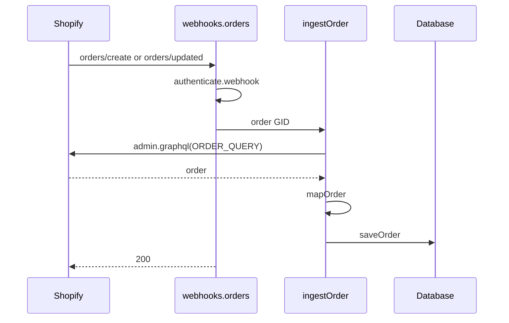
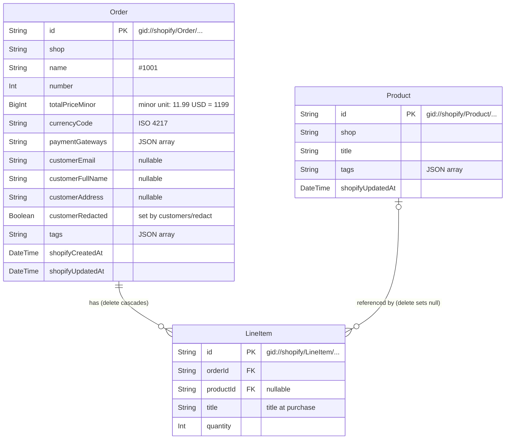

# Shopify Order Tags

[English](README.md) | 日本語

> これは [README.md](README.md) の翻訳です。内容が異なる場合は英語版を優先してください。ADR、要件、開発プロセスのドキュメントは英語です。

## 概要

Webhook で注文を取り込み、マーチャントが注文タグを追加・削除でき、注文を CSV にエクスポートできる Shopify アプリです。

このアプリは Shopify 管理画面に埋め込まれており、ホームページは注文一覧です。
注文は Shopify のデータのコピーとして保持し、タグの編集は先に Shopify に書き込みます。そのため、データの所有者は Shopify のままです。

**スコープ。** このアプリはこの課題のために作っています。1 つの開発ストアで `npm run dev` で実行し、レビュアーは 1 人で、他のサービスは必要ありません。本番規模よりも、実行が簡単な構成(SQLite、リクエスト内での Webhook 処理)を選んでいます。制限は測定済みです。1 回の Webhook にかかる時間は Shopify の 5 秒の制限に対して約 0.5 秒で、8 秒以内に送られた 39 回の Webhook(10 件の注文を同時に作成し、続けて同時にタグ付け)はすべて最初の試行で保存されました([測定結果](docs/adr/0005-process-webhooks-synchronously.md))。本番環境で必要になることは[既知の制限事項](#既知の制限事項--本番環境での考慮事項)にあります。

## 機能

| 課題の要件 | アプリの動作 |
|---|---|
| ストアの Webhook から注文を作成・更新する | ストアで注文が作成または更新されると、Webhook により、その注文と明細、商品のコピーをアプリのデータベースに保持します。**Sync orders** は、過去 60 日間の注文のうち、未保存のものと変更があったものをインポートします |
| 使いやすい画面で注文の一覧を表示する | 注文を新しい順に 1 ページ 25 件で表示します。番号、日付、顧客、メールアドレス、合計金額、決済ゲートウェイ、タグを表示します |
| 注文にタグを追加する | マーチャントは注文の行からタグを追加します。タグは Shopify に書き込まれるので、Shopify 管理画面にも表示されます |
| 注文からタグを削除する | マーチャントはタグの隣のボタンで削除します |
| 注文を CSV ファイルにエクスポートする | **Export CSV** は、ショップの全注文を明細ごとに 1 行でダウンロードします。各商品のタイトルとタグも含みます。[サンプルファイル](samples/orders.csv)で結果を確認できます |
| `order/id/.json` にないフィールドを含める: Product title、Product tags | CSV には、注文の JSON にはない各商品のタイトルとタグが含まれます |

- **顧客データ:** Shopify のコンプライアンス Webhook(Shopify がすべての公開アプリに求めるプライバシー関連の Webhook)を処理し、アプリがアンインストールされるとショップのデータを削除します([顧客データ](docs/database.ja.md#顧客データ)を参照)

### 注文一覧


### タグの編集


### CSV のダウンロード


## 必要なもの

- Node.js **24.22.1**(`.nvmrc`)
- 組織のある Shopify Partner アカウント([partners.shopify.com](https://partners.shopify.com))
- 開発ストア(下のステップ 4 で作成します)

## セットアップ

管理画面の操作手順とスクリーンショットを含む全手順は、[docs/setup.ja.md](docs/setup.ja.md) にあります。

1. 自分のアプリに接続します: `nvm use && npm ci && npm run config:link` を実行し、`shopify.app.toml` の `[access_scopes]` と `[webhooks]` を新しい `shopify.app.{name}.toml` にコピーします
2. Partner Dashboard で、アプリの **Public distribution** を選びます
3. Partner Dashboard で、保護された顧客データ(**Name**、**Email**、**Address**)へのアクセスを許可します
4. アプリを実行し、開発ストアにインストールします: `npm run dev`。データベースもこのとき作成されます
5. テスト用の決済ゲートウェイ(カード番号 `1`)でテスト注文を作成します。Webhook がその注文を保存します。注文一覧を 53 件の注文でまとめて埋めるには、`npm run seed:orders` を実行します([詳細](docs/setup.ja.md#53-件のテスト注文をまとめて追加する))
6. アプリのホームの **Sync orders** で既存の注文をインポートします
7. テストを実行します: `npm test`

## コマンド

| コマンド | 動作 |
|---|---|
| `npm run dev` | Shopify CLI 経由でアプリを実行し、データベースのマイグレーションを適用します |
| `npm test` | すべてのテストを 1 回実行します |
| `npm run typecheck` | ルートと GraphQL の型を再生成してから `tsc` を実行します |
| `npm run lint` | ESLint を実行します |
| `npm run build` | 本番用にアプリをビルドします |
| `npm run config:link` | 自分の組織にアプリを作成するか、既存のアプリを選択します |
| `npm run seed:orders -- --store <store>` | `shopify store auth` の後に、開発ストアに 53 件のテスト注文を作成します([詳細](docs/setup.ja.md#53-件のテスト注文をまとめて追加する)) |

## 技術スタック

| 領域 | 選択 | 理由 |
|---|---|---|
| フレームワーク | React Router 7 | Remix の後継で、Shopify の現在のアプリテンプレートです([アプリを React Router テンプレートで構築する理由](docs/adr/0001-react-router-template.md)) |
| UI | Polaris web components | Polaris React は今後更新されません([UI に Polaris web components を使う理由](docs/adr/0002-polaris-web-components.md)) |
| データベース | Prisma + SQLite | データベースサーバーの準備が不要です。[データベース](#データベース)を参照してください |
| Shopify API | Admin GraphQL API 2026-10 | Webhook は再取得のきっかけにすぎません。再取得とは、Admin API から注文を読み直すことです([アプリが各注文を再取得する理由](docs/adr/0003-refetch-order-via-graphql.md)) |
| テスト | Vitest | テストファーストで開発しました([テストファーストで開発した理由](docs/adr/0006-tdd.md)) |

実行時の依存関係が少ないのは、CSV やキューのライブラリを追加していないからです。CSV の書き出しは純粋関数で、Webhook はリクエスト内で処理します([Webhook をリクエスト内で処理する理由](docs/adr/0005-process-webhooks-synchronously.md))。

## ディレクトリ構成

```text
app/
  components/         presentational UI
  lib/
    domain/           pure functions: mapping, money, tag rules, CSV
    repositories/     database reads and writes
    shopify/          GraphQL queries and mutations
    *.server.ts       services: ingest an order, sync orders, edit tags
  routes/             loaders, actions and webhook routes
prisma/               schema and migrations
samples/              sample CSV export
test/                 tests by layer, helpers, captured API responses
docs/                 details, decision records, requirements, images
```

## 設計

### データフロー

注文の Webhook はきっかけにすぎません。Webhook には注文の GID(Shopify のグローバル ID。`gid://shopify/Order/…`)が含まれます。ルートはその ID を使って GraphQL で注文全体を再取得し、応答する前に書き込みます([アプリが各注文を再取得する理由](docs/adr/0003-refetch-order-via-graphql.md)、[Webhook をリクエスト内で処理する理由](docs/adr/0005-process-webhooks-synchronously.md))。



取得に失敗すると 2xx を返さないので、Shopify が配信を再試行します。**Sync orders** も同じ経路を通ります。`syncOrders` は `ORDER_IDS_QUERY` で注文を一覧し、`findStoredUpdatedAt` で比較して、新しい注文と変更があった注文ごとに `ingestOrder` を呼びます。`saveOrder` は、保存済みのより新しいコピーを上書きしません。

### レイヤー

| レイヤー | パス | ルール |
|---|---|---|
| ルート | `app/routes/` | リクエストを認証してから、サービスまたはリポジトリを呼びます |
| サービス | `app/lib/*.server.ts` | Shopify の呼び出しとデータベースの書き込みの順序を決めます |
| Shopify | `app/lib/shopify/` | GraphQL ドキュメント。`graphql-codegen` で型を付けます |
| ドメイン | `app/lib/domain/` | I/O のない純粋関数です |
| リポジトリ | `app/lib/repositories/` | 注文を読み書きする唯一のコードです |
| UI | `app/components/` | 表示のみを担当します |

意図的なトレードオフが 1 つあります。`domain/order-list-row.ts` と `domain/orders-csv.ts` は Prisma の型と `select` の定義を持つので、ドメイン層が永続化を知っています。これにより、データベースから読む列とブラウザに送る列(`customerAddress` を除く)を、型の付いた 1 か所で結び付けています。

### データベース



- **Shopify の GID を主キーにしています。** 同じ Webhook が繰り返し届いても同じ行に当たるので重複は生じず、アプリの ID と Shopify の ID の対応付けも不要です
- **`Product` は別テーブルです。** 商品は多くの明細に共有され、CSV には商品自体のタイトルとタグが必要です。`LineItem.title` は購入時のタイトルをフォールバックとして保持します
- **注文の合計金額は、通貨の最小単位の整数です。** String は合計できず、SQLite 上の Prisma の `Decimal` は浮動小数点の REAL だからです
- **タグと決済ゲートウェイは、String 列に入れた JSON 配列です。** SQLite に配列型がないからです

テーブル、削除時の動作、インデックスとその理由は [docs/database.ja.md](docs/database.ja.md) にあります。

### タグ

タグの追加と削除は、`tagsAdd` または `tagsRemove` で先に Shopify に書き込みます([タグを先に Shopify に書き込む理由](docs/adr/0004-sync-tags-to-shopify.md))。その後、アプリは Webhook と同じ方法で注文を再取得し、全体を保存します。入力のチェックは [注文タグ](docs/interpretation.ja.md#注文タグ) にあります。

### CSV

| 項目 | 形式 |
|---|---|
| 列 | CSV テンプレートの 9 項目を順番どおりに並べ、その後に *Product title* と *Product tags* を続けます |
| Order id | 数値の ID です。たとえば `gid://shopify/Order/6663058751643` の `6663058751643`。`order/id.json` の `id` および Shopify 管理画面の注文 URL の値です |
| Order number | ショップのプレフィックスを除いた番号です。たとえば `#1006` の `1006` |
| Total price | ショップの通貨の、記号なしの小数です: `11.99`、`1500`(JPY)、`1.234`(KWD) |
| 1 つのセルに複数の値(タグ、決済ゲートウェイ) | `, ` で連結し、引用符で囲みます |
| 日付 | UTC の ISO 8601 です。たとえば `2026-11-02T13:05:00Z`。ショップのタイムゾーンは保存しておらず、UTC はサーバーのタイムゾーンに依存しません |
| エンコーディング | BOM 付き UTF-8 です。Excel で ASCII 以外の氏名や住所を正しく開けます |
| 改行 | CRLF(RFC 4180) |
| エスケープ | RFC 4180 です(`,`、`"`、改行を含む値を引用符で囲み、`"` を 2 つ重ねます)。`,` と `;` の両方を区切り文字として受け付けるリーダーのため、`;` を含む値も引用符で囲みます |
| 数式セル | テキストのセル(決済ゲートウェイ、顧客フィールド、タグ、商品タイトル、商品タグ)が `=`、`+`、`-`、`@`、タブ、復帰、改行、全角の `＝`、`＋`、`－`、`＠` で始まる場合、先頭に `'` を付けます。スプレッドシートがそのようなセルを数式として実行する場合があるからです([OWASP](https://owasp.org/www-community/attacks/CSV_Injection))。同じ文字がセル内の `;` や改行の後に続く場合も、間の `"` の有無にかかわらず `'` を付けます(`x;=1+1` は `x;'=1+1` になります)。`;` を区切り文字とするスプレッドシートではカンマで行が分割されないので、値は `;` と改行ごとに切られ、引用符では防げません。区切り文字がカンマのマーチャントには、値の中のその `'` が見えます。数値の列と生成された列(order id、order number、total price、created at)には付かないので、負の合計金額は数値のままです |

ファイルのダウンロード方法とサンプルの内容は [CSV の形式](docs/interpretation.ja.md#csv-の形式) にあります。

### セキュリティと顧客データ

| 懸念事項 | アプリの動作 |
|---|---|
| Webhook の署名 | `authenticate.webhook` が HMAC を検証し、署名が無効なら 401 を返します |
| Webhook のショップ | ショップのヘッダーは署名されていません。そのため `app/uninstalled` と 2 つの redaction ルートは、署名されたペイロードが別のショップを指していれば 401 を返します |
| マーチャントのリクエスト | `authenticate.admin` がセッショントークンを検証し、注文はセッションのショップの分だけ読みます |
| 保存する顧客データ | 氏名、メールアドレス、住所を `Order` にのみ保存します。Shopify の顧客 ID は保存しません |
| `customers/redact` | 列挙された注文のこれらのフィールドを空にし、以後の取り込みでも空のまま保ちます |
| `app/uninstalled`、`shop/redact` | ショップの注文、明細、商品を削除します。ショップに再びセッションがある場合、`shop/redact` は何も削除しません |
| `customers/data_request` | トピックとショップのみをログに記録します |

詳細は [顧客データ](docs/database.ja.md#顧客データ) にあります。保存時の暗号化など、対応していない事項は[既知の制限事項](#既知の制限事項--本番環境での考慮事項)にあります。

## 課題の解釈

課題にはいくつか細部が定められていない点があります。その理由は [docs/interpretation.ja.md](docs/interpretation.ja.md) にあります。

| 問い | 選択 |
|---|---|
| CSV の 1 行は何か | 明細 1 つです。注文の列は繰り返し、数量が `0` の明細には行がありません |
| 商品タイトル | 商品自体のタイトルです。なければ購入時のタイトルを使います |
| 商品タグ | その商品を含む注文と一緒に取得した値で、商品ごとに 1 回保存します |
| 顧客の住所 | 配送先です。なければ請求先を使います |
| 顧客の氏名とメールアドレス | 注文の顧客と、注文のメールアドレスです。どちらも空の場合があります |
| 合計金額と数量 | 返金や編集を反映した現在の値で、ショップの通貨です |
| CSV の形式 | [CSV](#csv) を参照してください |
| 配布方法 | 公開です。Shopify App Store には掲載しません |
| 注文一覧の列 | 注文番号、作成日時、顧客、メールアドレス、合計金額、決済ゲートウェイ、タグ |
| どのタグを受け付けるか | 前後の空白を除きます。空、55 文字超、カンマを含むもの、注文に既にあるものは拒否します |

## テスト

テストに Partner アカウント、ストア、`.env` ファイルは不要で、開発はテストファーストで行いました([テストファーストで開発した理由](docs/adr/0006-tdd.md))。

テスト名は、[docs/requirements.md](docs/requirements.md) に記載された要件 ID(BE-1 〜 BE-6)で始まります。完全な形式は `BE-{n} {Feature} : {spec}. {test case}` です([Test naming](docs/requirements.md#test-naming))。

```bash
npm test                              # all tests once
npx vitest run -t "BE-3 Add tag"      # the tests of one requirement
```

| レイヤー | テストする内容 |
|---|---|
| ドメイン | 入力と出力。モックは使いません |
| リポジトリ | テスト用 SQLite データベースへの実際の読み書き |
| ルート | ローダー、アクション、署名付き Webhook。置き換えるのは `admin.graphql` だけで、取得済みのレスポンスを使います |
| UI | 描画される内容。jsdom の薄いテストです |

設定と実際のストアは手動で確認します: [テスト注文の作成](docs/setup.ja.md#5-テスト注文を作成する)、[既存の注文のインポート](docs/setup.ja.md#6-既存の注文をインポートする)、[コンプライアンス Webhook のサンプル送信](docs/database.ja.md#顧客データ)。

## 各要件の参照先

課題の各要件について、ID、実装するコード、テスト、その背景にある決定を示します。挙げたテストファイルは主なものです。`test/` で名前のプレフィックスを検索すると、残りも見つかります。

| 要件 | 実装 | テスト | 決定 |
|---|---|---|---|
| BE-1 ストアの Webhook から注文を作成・更新する | `app/routes/webhooks.orders.tsx`、`app/routes/app.sync.tsx`、`app/lib/ingest-order.server.ts` | `BE-1 Webhook ingestion`: `test/routes/webhooks.orders.test.ts`、`test/routes/app.sync.test.ts` | [アプリが各注文を再取得する理由](docs/adr/0003-refetch-order-via-graphql.md)、[Webhook をリクエスト内で処理する理由](docs/adr/0005-process-webhooks-synchronously.md) |
| BE-2 使いやすい画面で注文の一覧を表示する | `app/routes/app._index.tsx`、`app/components/order-table.tsx` | `BE-2 Order list`: `test/routes/app._index.test.ts` | [UI に Polaris web components を使う理由](docs/adr/0002-polaris-web-components.md)、[注文一覧の列](docs/interpretation.ja.md#注文一覧の列) |
| BE-3 注文にタグを追加する | `app/routes/app.tags.tsx`、`app/lib/tag-order.server.ts` | `BE-3 Add tag`: `test/routes/app.tags.test.ts` | [タグを先に Shopify に書き込む理由](docs/adr/0004-sync-tags-to-shopify.md)、[注文タグ](docs/interpretation.ja.md#注文タグ) |
| BE-4 注文からタグを削除する | `app/routes/app.tags.tsx`、`app/lib/tag-order.server.ts` | `BE-4 Remove tag`: `test/routes/app.tags.test.ts` | [タグを先に Shopify に書き込む理由](docs/adr/0004-sync-tags-to-shopify.md)、[注文タグ](docs/interpretation.ja.md#注文タグ) |
| BE-5 注文を CSV ファイルにエクスポートする | `app/routes/app.export.tsx`、`app/lib/domain/orders-csv.ts` | `BE-5 CSV export`: `test/domain/orders-csv.test.ts` | [CSV](#csv) |
| BE-6 `order/id/.json` にないフィールドを含める: Product title、Product tags | `app/lib/shopify/order-query.ts`、`app/lib/domain/order-mapper.ts` | `BE-6 Fields not in order JSON`: `test/repositories/order-repository.test.ts` | [アプリが各注文を再取得する理由](docs/adr/0003-refetch-order-via-graphql.md)、[商品タイトル](docs/interpretation.ja.md#商品タイトル-商品自体のタイトルを優先) |

## 既知の制限事項 / 本番環境での考慮事項

これらは[概要](#概要)のスコープから来るものです。主な項目を以下に示します。理由、関連する Issue、依存関係の監査を含む全項目は [docs/known-limitations.ja.md](docs/known-limitations.ja.md) にあります。

### スコープの判断

- Webhook は 1 つの SQLite 接続でリクエスト内で処理します。本番環境については[行 1 と 2](#本番環境への移行)を参照してください
- 保存するのは注文の最初の 250 明細だけです(GraphQL クエリの 1 ページ)。それを超える明細は保存されず、CSV にも入りません
- アクセストークンと顧客データは保存時に暗号化していません
- `customers/data_request` はリクエストをログに記録するだけです
- CI とデプロイ設定はありません

### 既知の問題

- ショップのオフライントークン(マーチャントがいないときにアプリが使うアクセストークン)の期限が切れていると `app/uninstalled` の配信が失敗し、ショップのデータが削除されません
- 署名付きの `app/uninstalled` の配信は再インストール後に再送でき、遅れた再試行でも同じことが起こり得ます。その場合、新しいインストールのデータが削除されます
- タグの編集と同じ秒に行われた Webhook の取得が、保存済みのコピーからその編集を消してしまう場合があります

### 本番環境への移行

本番環境で設計がどう変わるかを示します。ここに書いたものはどれも実装していません。各行の理由と根拠は[本番環境への移行](docs/known-limitations.ja.md#本番環境への移行)にあります。

| # | ボトルネック | 本番環境の設計 | 理由 |
|---|---|---|---|
| 1 | 応答が処理を待ち、Webhook に応答するのは注文を取得して保存した後です(約 0.5 秒)。 | 署名を検証し、配信を永続的なキューに入れて応答し、取得、保存、失敗時の再試行は別のプロセスに任せます。 | 処理時間や注文の集中によって、応答が期限に間に合うかどうかが左右されなくなります。 |
| 2 | 書き込みは 1 つのデータベースファイルへの 1 つの接続で 1 つずつ実行し、このためアプリは 1 台のマシンに縛られます。 | 同時書き込みができるデータベースと状態を持たないアプリにして、複数のインスタンスを実行できるようにします。 | インスタンスの数に応じて処理能力が増え、1 つの障害でアプリが止まらなくなります。 |
| 3 | コピーを最新に保つのは Webhook だけで、取りこぼしの回復は誰かが **Sync orders** を押すことに依存しています。 | 前回の実行以降に変更された注文を取得し、取りこぼした Webhook を補う定期的な照合を追加します。 | 配信は保証されず、再試行には終わりがあります。 |
| 4 | 処理した Webhook を記録しておらず、重複する注文の Webhook は冪等な書き込みと `updatedAt` のチェックで吸収しますが、削除の Webhook を再送すると再インストールしたショップのデータが削除されます。 | 処理した Webhook を記録して重複を飛ばし、削除の Webhook をインストール日時と比較しますが、配信 ID と配信日時は署名の対象外のヘッダーなので、再送を完全には防げません。 | 同じ Webhook が複数回届くことがあり、削除は元に戻せません。 |
| 5 | 顧客データの扱いは開発用のままで、保存時に暗号化しておらず、データのリクエストはログに記録するだけで、削除の Webhook はセッションに依存し、トークンの期限が切れていると失敗します。 | 保存時に暗号化し、データのリクエストに求められた期間内に応え、削除はセッションなしで署名だけで実行できるようにします。 | これらはプラットフォームの要件で、削除は必ず実行されなければなりません。 |
| 6 | 大きなデータを 1 つのまとまりとして扱っており、明細は 250 件の 1 ページ、CSV は 1 つのリクエスト内でメモリ上に作成、同期は 1 注文ずつです。 | 明細はページをたどって取得し、CSV はストリーミングするかバックグラウンドで作成して後で渡し、同期はバックグラウンドの一括取得として実行します。 | 大規模なストアでは、データが失われ、遅くなり、他の処理を止めることになります。 |
| 7 | アプリは開発者のマシンでしか動かず、デプロイ設定、CI、監視がないので、障害に気づけません。 | ビルド、テスト、デプロイを自動化し、失敗または拒否された Webhook を監視してアラートを出し、シークレットをコードの外に置きます。 | 気づかれない障害は再試行が終わるまで続き、データが失われます。 |
| 8 | 依存関係はテンプレートのバージョンのままで、本番の依存関係に既知の問題が 6 件あります。 | 依存関係を定期的に更新し、監査を続けます。 | 現在の問題があるパッケージはリクエストのデータを扱いませんが、問題は蓄積します。 |

## 開発プロセス

要件、対応する Issue、テストの命名は [docs/requirements.md](docs/requirements.md) にあります。ルールは 3 つのドキュメントにあります。

- **Issue ファーストの TDD([CONTRIBUTING.md](CONTRIBUTING.md)):** 変更はテストリスト付きの Issue から始まります。専用のブランチでテストファーストで作り、実行した内容、リスク、ロールバック方法を記録したプルリクエストを通じて `main` に入ります
- **コードレビュー([REVIEW.md](REVIEW.md)):** プルリクエストは、コードを書いていないエージェントがレビューします。修正と確認は 1 回までです。マージは作者が判断します
- **セキュリティレビュー([SECURITY_REVIEW.md](SECURITY_REVIEW.md)):** プルリクエストが認証、Webhook、顧客データ、Shopify への書き込み、スコープ、エクスポート、依存関係に触れる場合に必要です

### コミット履歴の読み方

プルリクエストはマージコミットでマージし、squash と rebase によるマージは無効にしています。そのため、各変更のコミットが履歴に残ります。

```bash
git log --first-parent --oneline main                       # one merge per pull request, after the first setup commits
git log --no-merges --oneline --reverse --grep='(#3)' main  # the commits of one issue, oldest first
```

Issue の中では、`test:` コミットが失敗するテストを追加し、`feat:` または `fix:` コミットがそれを通し、`refactor:` コミットが整理します。各メッセージの末尾には Issue 番号があります。ブランチ内のコミットではテストが失敗することがあるので、テストが通ると期待できるのは `main` のマージコミットだけです。
既知の例外は [PR #90](https://github.com/rukiita/shopify_test/pull/90) の "Commit history" に記載しています。最初のプルリクエストより前のセットアップのコミットと、既存の動作を記述した #90 自体の `test:` コミットも、このパターンの対象外です。

## ドキュメント

作業の評価は README だけで十分です。詳細は以下のファイルにあります。

| ファイル | 内容 |
|---|---|
| [docs/setup.ja.md](docs/setup.ja.md) | インストールと設定の全手順 |
| [docs/database.ja.md](docs/database.ja.md) | テーブル、設計上の選択、削除時の動作、顧客データ |
| [docs/interpretation.ja.md](docs/interpretation.ja.md) | 課題の各解釈の理由 |
| [docs/known-limitations.ja.md](docs/known-limitations.ja.md) | すべての制限事項、本番環境の設計とその根拠、依存関係の監査 |
| [docs/adr/](docs/adr/README.md) | Architecture Decision Records(ADR): この README からリンクしている設計上の決定。それぞれの選択肢と理由、および要約の表があります |
| [docs/requirements.md](docs/requirements.md) | 要件、対応する Issue、テストの命名 |
