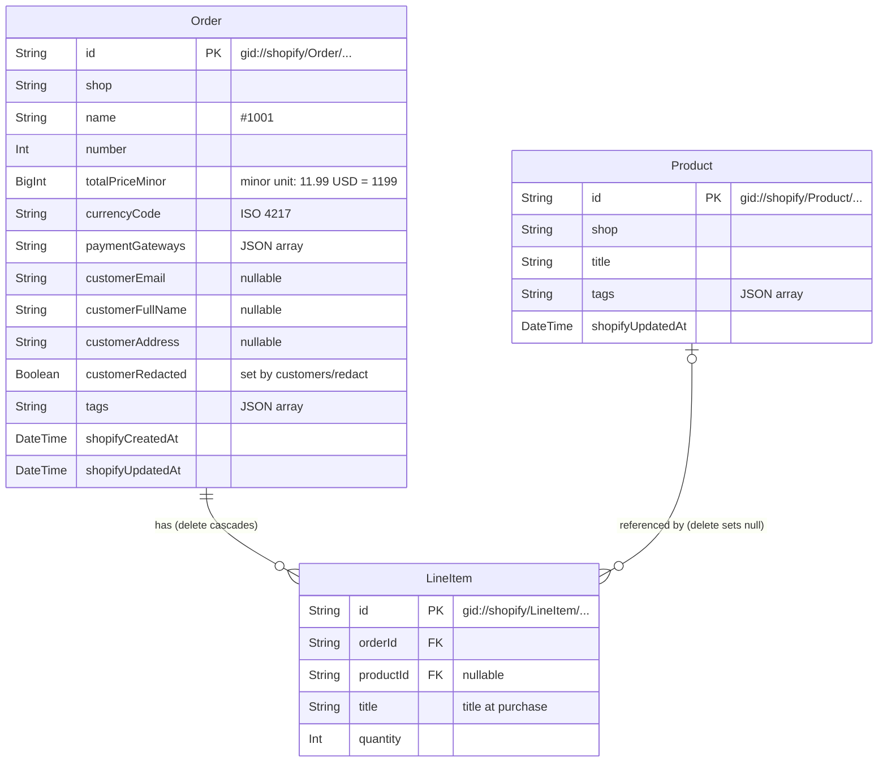

# Shopify Order Tags

A Shopify app that captures orders through webhooks, lets merchants add and remove order tags, and exports orders to CSV.

> Sections marked _(to be written)_ are filled in as the work progresses. Each one names the step and issue that completes it.

## Contents

- [Features](#features)
- [Screenshots](#screenshots)
- [Installation and configuration](#installation-and-configuration)
- [Database design](#database-design)
- [Interpretation of the task](#interpretation-of-the-task)
- [Implementation choices](#implementation-choices)
- [Development process](#development-process)
- [Known limitations / Production considerations](#known-limitations--production-considerations)

## Features

_(to be written — Step 8, #9)_

## Screenshots

_(to be written — Step 8, #9)_

## Installation and configuration

> **Draft.** Written while setting up the author's environment (#19). It will be verified step by step in a fresh environment and finalised in Step 8 (#11). Shopify admin labels are given in English and will be checked against the English admin then.

### Prerequisites

- Node.js **24.22.1** (pinned in `.nvmrc`; with nvm, run `nvm use`). The app also declares `>=22.12` in `package.json`, and `.npmrc` makes `npm` refuse older versions, but 24.22.1 is the version it was built and tested with
- A Shopify Partner account with an organization ([partners.shopify.com](https://partners.shopify.com)). Without an organization, Shopify CLI stops with "No Organization found"

Shopify CLI is a project dependency (`@shopify/cli` in `devDependencies`), so no global install is needed. Run it through the npm scripts or `npx shopify`.

### 1. Install dependencies and connect your own app

```bash
nvm use               # Node.js version from .nvmrc
npm ci                # install exactly the versions in package-lock.json
npm run config:link   # create or select an app in your own organization
```

`shopify.app.toml` contains the author's `client_id`. `config:link` replaces it with an app in your organization.

### 2. Choose the distribution method

In the Partner Dashboard, open your app and choose **Public** distribution. Shopify requires a distribution method before protected customer data can be requested. The choice cannot be changed later. The app does not need to be listed on the App Store.

### 3. Allow access to protected customer data

Order webhooks and the CSV export need customer names, emails and addresses.

1. In the **Partner Dashboard** (not the Dev Dashboard), go to **Apps**, open your app from the list of Dev Dashboard apps, then **API access requests** → **Protected customer data access**
2. Select **Protected customer data**, and the fields **Name**, **Email** and **Address**, with the reason "App functionality"
3. Save. Step 2 (data protection details) is only needed for App Store review, not for development stores

### 4. Run the app on a development store

```bash
npm run dev
```

When asked, create a new development store (any plan works; **Basic** is recommended, and **demo data** gives you products and orders to start with), then open the preview URL and install the app.

Scopes (`read_customers`, `read_orders`, `read_products`, `write_orders`) and webhook subscriptions are declared in `shopify.app.toml` and applied by `npm run dev`; no manual setup is needed.

### 5. Place a test order

Development stores use the Bogus Gateway for payments by default.

1. Open the online store from the Shopify admin (**Sales channels** → **Online Store** → eye icon). The storefront password is under **Online Store** → **Preferences**
2. Add products to the cart and check out with test data, e.g. email `test.buyer+1@example.com`, a US address
3. Pay with card number `1`, any future expiry date, any 3-digit security code, and name on card `Bogus Gateway`

The `orders/create` webhook stores the order while `npm run dev` is running. To see it, open the development database with `npx prisma studio` (tables `Order`, `LineItem`, `Product`). Editing the order in the Shopify admin (for example, adding a tag) sends `orders/updated`, which updates the stored copy.

### 6. Import existing orders

Webhooks only report orders placed or changed after the app was installed. To import the orders placed before that, open the app and click **Sync orders** on the app home. The button is disabled while the sync runs, and then shows how many orders were imported. The sync lists the orders with their `updatedAt` and fetches only those not stored yet or changed since they were stored; each of them goes through the same refetch and write as a webhook ([ADR-0003](docs/adr/0003-refetch-order-via-graphql.md)). So a second sync imports `0` orders if nothing changed. If a sync stops partway, the page says how many orders were imported before it stopped, and running it again continues from there.

The app has `read_orders` without `read_all_orders`, so the Admin API lists only orders created in the last 60 days ([access scopes](https://shopify.dev/docs/api/usage/access-scopes)), and the sync imports only those. `read_all_orders` needs Shopify's approval for an app created under a Partner organization (#21).

_(Database setup, running the tests, and the remaining steps are added in Step 8.)_

## Database design

The database is SQLite, managed with Prisma (`prisma/schema.prisma`). Orders, line items and products are copies of Shopify data. Shopify owns the data ([ADR-0004](docs/adr/0004-sync-tags-to-shopify.md)). The copies are written in four ways:

- **Ingestion:** an `orders/create` or `orders/updated` webhook, or the sync of existing orders ([step 6](#6-import-existing-orders)), refetches the order from the Admin API and writes the order, its line items and their products. An order and its line items are written unless Shopify's `updatedAt` is older than the stored `shopifyUpdatedAt` (an equal value is written: `updatedAt` has one-second precision, so it can carry a later change made in the same second), a guard for two fetches of the same order running at the same time ([ADR-0003](docs/adr/0003-refetch-order-via-graphql.md)). Each product is written the same way, unless the product's own `updatedAt` is older than its stored `shopifyUpdatedAt`: two orders with the same product can be ingested at the same time (#6)
- **Tag edits:** adding or removing an order tag in the app writes to Shopify first, then to the database ([ADR-0004](docs/adr/0004-sync-tags-to-shopify.md))
- **Compliance webhooks:** `customers/redact` empties an order's customer fields, and `shop/redact` deletes an uninstalled shop's data (see [Customer data](#customer-data))
- **Deletion:** the app does not subscribe to Shopify's delete webhooks (`orders/delete`, `products/delete`), so deletions in Shopify are not received (see "Delete behaviour" under [Design choices](#design-choices))



### Tables

| Table | Holds | Notes |
|---|---|---|
| `Order` | One row per Shopify order, scoped to a shop | `customerAddress` is one formatted string (shipping, falling back to billing). `customers/redact` sets `customerEmail`, `customerFullName` and `customerAddress` to null and `customerRedacted` to true, and later ingestions keep the three fields null (see [Customer data](#customer-data)) |
| `LineItem` | One row per line item of an order | `productId` is null when the line item had no product the last time its order was ingested: a custom item, or a product already deleted in Shopify |
| `Product` | One row per product seen on an ingested order, scoped to a shop | Title and tags as fetched with an order containing the product, written by each ingestion of such an order. `shopifyUpdatedAt` is the product's `updatedAt` in Shopify, so when two such ingestions run at the same time, the older fetch is not written over the newer one. `app/uninstalled` and `shop/redact` delete a shop's products |
| `Session` | Shopify OAuth sessions, from the app template | Unchanged from the template; not related to the other tables, so not in the diagram |

### Design choices

**Shopify GIDs are the primary keys** (`gid://shopify/Order/...`, `.../LineItem/...`, `.../Product/...`).

- The webhook carries the GID (`admin_graphql_api_id`), and the GraphQL refetch ([ADR-0003](docs/adr/0003-refetch-order-via-graphql.md)) takes it as is
- Upserting the same object twice hits the same row, so a repeated webhook creates no duplicate
- No mapping between an app ID and a Shopify ID is needed

**`Product` is a separate table.** A product is shared by many line items, across orders, and the CSV needs the product's own title and tags rather than what the line item carries (see [Interpretation of the task](#interpretation-of-the-task)). Storing them once per product means every line item of that product shows the same values. They are refreshed whenever an order containing the product is ingested, not when the product itself changes. `LineItem.title` keeps the title at purchase as the fallback when the line item has no product.

**Delete behaviour.** The app subscribes to `orders/create`, `orders/updated`, `app/uninstalled` and `app/scopes_update`, and to the compliance webhooks `customers/data_request`, `customers/redact` and `shop/redact`. None of them reports a deleted order or product, so a deletion in Shopify does not delete rows here. `app/uninstalled` deletes the shop's orders, line items, products and sessions, on every delivery of it. `shop/redact`, which Shopify sends 48 hours after the uninstall, deletes the shop's orders, line items and products again, so anything written after `app/uninstalled` is removed too. If the app was installed again in those 48 hours, `shop/redact` deletes nothing. What `customers/redact` changes is under [Customer data](#customer-data).

A product deleted in Shopify shows up only on orders ingested again afterwards. For a deleted product the refetch returns no product (`product: null`, confirmed with a captured response in #6), so `productId` becomes null and the CSV falls back to the title at purchase. Other orders containing that product keep showing its stored title and tags.

The foreign keys define what happens when a row is deleted in the app's database. Deleting an order deletes its line items (`onDelete: Cascade`). Deleting a product keeps its line items and sets their `productId` to null (`onDelete: SetNull`), so the order and the title at purchase stay in the CSV. `app/uninstalled` and `shop/redact` delete a shop's orders (their line items go with them) and its products.

**Tags and payment gateways are JSON arrays in String columns**, e.g. `["VIP","wholesale"]`. SQLite has no array type. JSON keeps a value unambiguous whatever characters it contains (a comma-separated string would not), and adding or removing one tag is an array operation. Filtering by tag in SQL is not needed by the current requirements.

**The order total is an integer in the currency's minor unit** (`totalPriceMinor`: 11.99 USD → `1199`, 1500 JPY → `1500`), stored with `currencyCode`. A String column cannot be summed with Prisma's `_sum`, and a Prisma `Decimal` on SQLite is stored as a floating-point REAL, so the total is kept as an integer. Totals across orders are summed per currency. The column is a `BigInt`, which Prisma returns as a JavaScript `bigint`. A 32-bit `Int` would cap one order at 2,147,483,647 minor units (about 21 million USD, or 2.1 million in a 3-decimal currency such as KWD), and one larger order would make every query that returns its row fail.

**Indexes.** `Order(shop, shopifyCreatedAt)` serves the order list (a shop's orders, newest first). `LineItem(orderId)` and `LineItem(productId)` are indexed because SQLite does not index foreign keys on its own. `Product(shop)` is not a foreign key index (`shop` is a plain column). It serves deleting a shop's products on `app/uninstalled` and `shop/redact`.

### Customer data

The app stores three customer fields, on `Order` only: `customerEmail`, `customerFullName` and `customerAddress`. They are copied from the merchant's own orders in Shopify. No other table holds customer data, and the app does not store the Shopify customer ID.

Shopify requires every public app, listed on the App Store or not, to handle three compliance webhooks. The app subscribes to them in `shopify.app.toml` (`compliance_topics`). Each route verifies the HMAC signature and returns 401 for an invalid one. The shop comes from the `X-Shopify-Shop-Domain` header, which the signature does not cover, so the two redaction routes also return 401 when the signed payload's `shop_domain` names another shop. Otherwise each route responds 200 after doing the following:

| Topic | When Shopify sends it | What the app does |
|---|---|---|
| `customers/redact` | 10 days after a merchant requests the deletion of a customer's data | Sets the three customer fields to null on the orders listed in `orders_to_redact`, within the shop, and sets `customerRedacted`. A later ingestion of such an order (for example `orders/updated` after a refund) keeps the three fields null, whatever Shopify returns. The order, its line items and tags stay, as they do in Shopify. Listed orders the app never stored are skipped |
| `shop/redact` | 48 hours after the app is uninstalled | Deletes the shop's orders, line items and products, as `app/uninstalled` does. If the shop has a session again (the app was installed again in those 48 hours), it deletes nothing: `app/uninstalled` deletes the sessions, and the data then belongs to the new install. Shopify's documentation does not say whether a reinstall cancels `shop/redact` |
| `customers/data_request` | When a customer asks a merchant for their data | Nothing beyond logging the topic and shop; customer details are not logged. The app sends nothing to the customer. The stored fields are copies of the merchant's own orders, so the merchant already has them in the Shopify admin. The app's order list shows the name and email, and the CSV export shows all three |

Orders are matched by ID only (`orders_to_redact`, numeric IDs turned into GIDs), because the app does not store the customer ID. Customer data on an order not in that list stays. The routes do not need a session, so redaction also runs after the app was uninstalled.

To check the routes by hand, run the app (`npm run dev`) and send Shopify's sample payloads with `npx shopify app webhook trigger --topic customers/data_request` (or `customers/redact`, `shop/redact`), giving the app's local address and client secret when asked. `customers/data_request` returns 200. The two redaction routes return 401 for the samples: their `shop_domain` is the placeholder `{shop}.myshopify.com`, which does not match the shop in the header. The redaction itself is covered by the route tests (`test/routes/webhooks.customers.redact.test.ts`, `test/routes/webhooks.shop.redact.test.ts`).

## Interpretation of the task

The task leaves some details open. These are the readings this app follows (decided in #18).
The app uses public distribution, so any store can install it. It is not listed on the Shopify App Store.

### CSV rows: one row per line item

Each row is one line item. Order columns (order id, number, total, customer, tags, …) repeat on every row of the same order. A line item with quantity `0`, which was removed by an order edit or refunded, has no row, so the rows match the order as it is now.

This keeps one product title and one set of product tags per row, so the file can be filtered and pivoted in a spreadsheet.

> **Note:** because order columns repeat, summing *Total price* over all rows counts an order once per line item. Sum distinct orders instead.

### Product title: the product's own title, falling back to the title at purchase

*Product title* is the product's own title (`Product.title`), fetched and refreshed the same way as the product tags below. If the line item has no product (`productId` is null; see the `LineItem` row under [Database design](#database-design)), the title recorded on the line item at purchase (`LineItem.title`) is used.

The task lists *Product title* among the fields "not in order/id/.json". The order already carries the title at purchase on each line item, so the field asked for is read as the product's own title.

### Product tags: as fetched with an order containing the product

Product tags are fetched together with the order whenever an order is ingested (`orders/create`, `orders/updated`, or a sync), and stored once per product. A sync ingests only orders not stored yet or changed since they were stored, so it does not refresh the tags of products on unchanged orders. Each ingestion of an order containing the product writes them, unless the stored product is newer (see the `Product` row under [Database design](#database-design)), so every line item linked to the product shows the same stored tags, not the tags as of its own order's ingestion. A line item with no product has an empty *Product tags* cell: unlike the title, no tags are recorded at purchase. The app does not update products from product webhooks or events, so a tag change on a product shows up the next time an order containing it is ingested. A product deleted in Shopify keeps its stored title and tags on orders that are not ingested again.

### Customer address: shipping address, falling back to billing

*Customer address* is the order's shipping address. Orders without one (for example, digital goods) use the billing address.
The address lines from Shopify (`formatted`, without the name) are joined with `, `, e.g. `123 Test Street, San Francisco CA 94103, United States`.

### Customer name and email

*Customer full name* is the order's customer, first and last name. *Customer email* is the email on the order. Both can be empty, for example for an order created in the admin without choosing a customer. Reading the customer requires the `read_customers` scope (#1).

### Total price and quantity: current values, in the shop's currency

*Total price* is the order's current total (`currentTotalPriceSet`) in the shop's currency: after refunds, returns and order edits, including taxes and discounts. A line item's quantity is its current quantity (`currentQuantity`), so a line item removed by an order edit is expected to stay with quantity `0` (read from the API reference, not yet confirmed with a captured response). Both match the order as it is now in the Shopify admin. Decided in #1.

### CSV format

| Item | Format |
|---|---|
| Columns | The nine fields of the CSV template, in order, followed by *Product title* and *Product tags* |
| Order id | The numeric ID, e.g. `6663058751643` from `gid://shopify/Order/6663058751643`. It is the `id` in `order/id.json` and in the Shopify admin's order URL |
| Order number | The number without the shop's prefix, e.g. `1006` for `#1006` |
| Total price | A plain decimal in the shop's currency, without a symbol: `11.99`, `1500` (JPY), `1.234` (KWD) |
| Multiple values in one cell (tags, payment gateways) | Joined with `, ` and quoted |
| Dates | ISO 8601 in UTC, e.g. `2026-11-02T13:05:00Z`. The shop's time zone is not stored, and UTC does not depend on the server's |
| Encoding | UTF-8 with a BOM, so Excel opens non-ASCII names and addresses correctly |
| Line endings | CRLF (RFC 4180) |
| Escaping | RFC 4180 (values containing `,`, `"` or line breaks are quoted; `"` is doubled). Values containing `;` are quoted too: it is the separator in Excel in some locales, where the rest of the value would otherwise become a cell of its own |
| Formula cells | A text cell (payment gateway, customer fields, tags, product title, product tags) starting with `=`, `+`, `-`, `@`, tab, carriage return, line feed or a full-width `＝`, `＋`, `－`, `＠` gets a leading `'`, because a spreadsheet can run such a cell as a formula ([OWASP](https://owasp.org/www-community/attacks/CSV_Injection)). Numeric and generated columns (order id, order number, total price, created at) never do, so a negative total stays a number |

Merchants download the file with the **Export CSV** button above the order list, which is shown once the shop has orders. The file has all of the shop's orders, newest first, with an order's rows in a stable order, and is built from the app's database, so an export makes no Shopify API call. An order with no line items left still gets one row, with the product columns empty.

### Distribution: public

The app uses public distribution, so any store can install it. It is not listed on the Shopify App Store.

### Order list columns

Order number, created at, customer, email, total, payment gateway, tags. These are the CSV fields needed to tell orders apart at a glance; the full set is in the CSV.

Orders are listed newest first, 50 per page, from the app's database, so a page view makes no Shopify API call. *Created at* is shown in the browser's time zone: the app does not store the shop's time zone, so it can differ from the Shopify admin when the two zones differ. *Total* is shown in the order's stored currency, formatted in English (`$11.99`, `¥1,500`).

### Order tags

Merchants add a tag from the order's row in the list. The tag is checked before it is sent to Shopify:

| Input | Result | Why |
|---|---|---|
| Surrounding whitespace | Trimmed | |
| Empty | Rejected | |
| Contains a comma | Rejected | `tagsAdd` splits `a,b` into two tags |
| Over 55 characters | Rejected | Shopify answers `Order tags is invalid` from 56. An emoji counts as one character |
| The order already has it, in any case | Rejected | `tagsAdd` treats `vip` as an existing `VIP`, and does nothing |

The limit and the behaviour above were measured on the development store (Admin API 2026-10, #3); the documentation does not state them. The check uses the stored copy of the tags, which can be behind Shopify. A tag added in the Shopify admin a moment ago may not be caught, and `tagsAdd` then does nothing for it. A duplicate found in the stored copy is checked again against a refetch of the order, so a tag removed in the Shopify admin a moment ago can be added back.

Merchants remove a tag with the button next to it. The tag is sent exactly as it is stored, because `tagsRemove` matches case-sensitively and ignores a tag it does not find, without an error. It does not go through the checks above, so a tag added elsewhere that they would reject can still be removed. If the response still has the tag, in any case, the merchant gets an error, and the order is stored again so that trying again uses the tag as Shopify has it.

After a tag edit, the app refetches the order and stores it whole, the same way as a webhook ([ADR-0003](docs/adr/0003-refetch-order-via-graphql.md)). So the stored `updatedAt` always describes all of the order's columns, and an edit that changed nothing in Shopify, which sends no `orders/updated`, still brings the copy up to date. A webhook's fetch from before the edit is older, so it is skipped when it finishes late. If the refetch fails, the merchant is still told the edit worked, because it reached Shopify; the `orders/updated` for it repairs the copy.

## Implementation choices

Design decisions are recorded as Architecture Decision Records in [docs/adr/](docs/adr/README.md).

_(summary to be written — Step 8, #12)_

## Development process

This repository is developed issue-first with TDD. See [CONTRIBUTING.md](CONTRIBUTING.md) and [docs/requirements.md](docs/requirements.md).

_(to be expanded — Step 8)_

## Known limitations / Production considerations

_(to be completed — Step 8, #12)_

- `read_customers` was added after the first install (#1). A store installed before that has it only once the merchant opens the app and approves the new scope. Until then the order query is denied, and order webhooks for that store fail and are retried
- The CSV export reads all of a shop's orders and builds the file in memory within one request, which has not been measured on a large store. The read shares the one SQLite connection, and building the file holds the Node process, so order webhooks for every shop wait meanwhile and can pass Shopify's 5-second limit, which leaves them to Shopify's retries. For large stores, stream the rows or build the file in a background job (#5)
- The CSV has no currency column. *Total price* is in the currency the shop had when the order was last ingested, so the column can mix currencies after a shop changes its currency (#5)
- *Order id* is a plain number of 13 or more digits. Excel is expected to display it in scientific notation, and saving the file from Excel can then write the rounded form (not checked in Excel yet). Keep the original file, or import the column as text (#5)
- The `'` prefix stops a formula when the file is opened, but OWASP warns that Excel may strip quotes and escape characters after a file is saved and reopened (#5)
- Only the first 250 line items of an order are stored (one GraphQL page, `lineItems(first: 250)`). Line items beyond that are not stored and not in the CSV (#1)
- Order webhooks are processed within the request: the order is fetched and stored before the app responds ([ADR-0005](docs/adr/0005-process-webhooks-synchronously.md)). One delivery takes about 0.5 s against Shopify's 5-second limit. Database writes run one at a time over one SQLite connection, so deliveries that arrive at the same time wait for each other (#77). A burst of more than about 75 large or 170 small orders at once (measured on the database write alone; through the route it may be fewer) fails in part and is left to Shopify's retries. In production, process webhooks from a queue, use a database that allows concurrent writes, and reconcile orders whose deliveries were dropped. No reconciliation job is planned; the sync ([step 6](#6-import-existing-orders)) can be run by hand and imports the orders from the last 60 days that are missing or changed
- `customers/redact` marks only orders the app has already stored. An order in `orders_to_redact` that is stored later (for example by the sync of existing orders) gets its customer fields as Shopify returns them then (#65)
- `updatedAt` has one-second precision, and a fetch with an equal value is written, because it can carry a later change made in the same second. So a webhook's fetch from before a tag edit, in the same second as the edit, can undo the edit in the stored copy if it is written last. The copy stays that way until the order next changes, and a sync does not repair it, because it skips orders with the same `updatedAt` (#3)
- The sync of existing orders runs within one request, one order at a time: it lists orders 250 per page, then fetches and writes each new or changed order as a webhook would. Its time grows with the number of orders to import (the same fetch and write take about 0.5 s per webhook delivery; the sync itself has not been measured on a large store). A request that Shopify answers with 429 or 503 is tried up to three times. The GraphQL rate limit is reported as a `THROTTLED` error with status 200, which is not retried: the sync stops, the orders imported before it stay, and running it again continues with the orders not imported yet. Fetching several orders at once is not done (#70). For large stores, run it as a background job with a bulk operation instead (#21)

### Dependency audit

The app was scaffolded from [`shopify-app-template-react-router`](https://github.com/Shopify/shopify-app-template-react-router) version **2026.10.09**, and keeps the dependency versions it pins.

`npm audit` on a clean install (`npm ci`, 2026-10-31) reports 39 issues (26 high, 13 moderate). Most come from development-only tools (ESLint, GraphQL codegen, the Prisma CLI). Limited to production dependencies (`npm audit --omit=dev`), there are 6 (4 high, 2 moderate), from two root causes:

| Package | Reached through | Issue | Why the risk is low here |
|---|---|---|---|
| `deepmerge-ts` | `prisma` → `@prisma/config` | Stack exhaustion when merging recursive objects | Used when Prisma loads its configuration, not on request data |
| `minimatch` | `@react-router/fs-routes` | ReDoS with crafted glob patterns | Used to match route file names at build time, not on request data |

Fixing them requires major upgrades (Prisma 7 and newer ESLint / TypeScript ESLint), which would diverge from the template and risk the database work in this task. They are deferred. In production, upgrade to the fixed majors and re-run `npm audit`.
