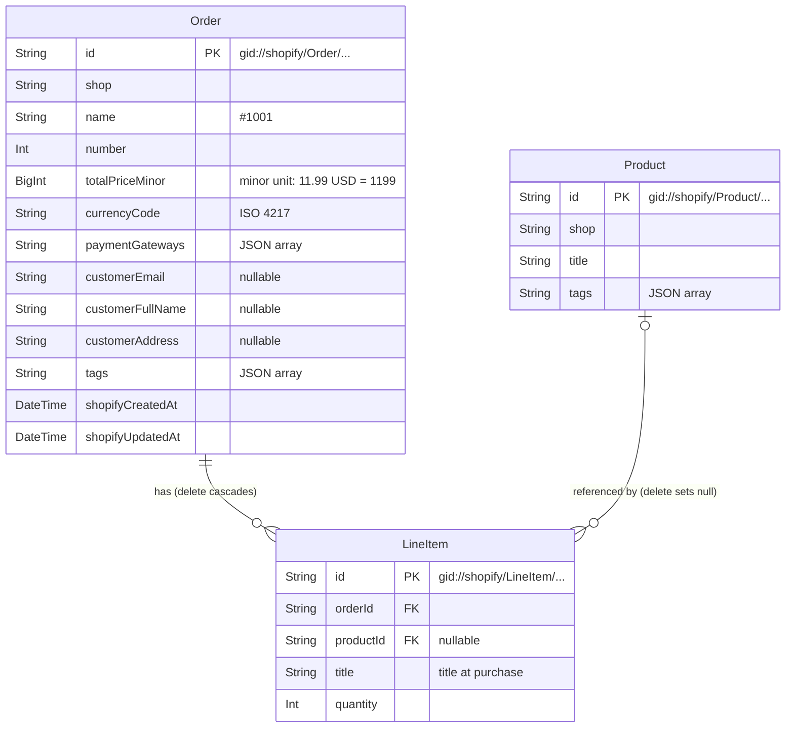

# Shopify Order Tags

A Shopify app that captures orders through webhooks, lets merchants add and remove order tags, and exports orders to CSV.

> Sections marked _(to be written)_ are filled in as the work progresses. Each one names the step and issue that completes it.

## Contents

- [Features](#features)
- [Screenshots](#screenshots)
- [Installation and configuration](#installation-and-configuration)
- [Database design](#database-design)
- [Interpretation of the task](#interpretation-of-the-task)
- [Implementation choices](#implementation-choices)
- [Development process](#development-process)
- [Known limitations / Production considerations](#known-limitations--production-considerations)

## Features

_(to be written — Step 8, #9)_

## Screenshots

_(to be written — Step 8, #9)_

## Installation and configuration

> **Draft.** Written while setting up the author's environment (#19). It will be verified step by step in a fresh environment and finalised in Step 8 (#11). Shopify admin labels are given in English and will be checked against the English admin then.

### Prerequisites

- Node.js **24.22.1** (pinned in `.nvmrc`; with nvm, run `nvm use`). The app also declares `>=22.12` in `package.json`, and `.npmrc` makes `npm` refuse older versions, but 24.22.1 is the version it was built and tested with
- A Shopify Partner account with an organization ([partners.shopify.com](https://partners.shopify.com)). Without an organization, Shopify CLI stops with "No Organization found"

Shopify CLI is a project dependency (`@shopify/cli` in `devDependencies`), so no global install is needed. Run it through the npm scripts or `npx shopify`.

### 1. Install dependencies and connect your own app

```bash
nvm use               # Node.js version from .nvmrc
npm ci                # install exactly the versions in package-lock.json
npm run config:link   # create or select an app in your own organization
```

`shopify.app.toml` contains the author's `client_id`. `config:link` replaces it with an app in your organization.

### 2. Choose the distribution method

In the Partner Dashboard, open your app and choose **Public** distribution. Shopify requires a distribution method before protected customer data can be requested. The choice cannot be changed later. The app does not need to be listed on the App Store.

### 3. Allow access to protected customer data

Order webhooks and the CSV export need customer names, emails and addresses.

1. In the **Partner Dashboard** (not the Dev Dashboard), go to **Apps**, open your app from the list of Dev Dashboard apps, then **API access requests** → **Protected customer data access**
2. Select **Protected customer data**, and the fields **Name**, **Email** and **Address**, with the reason "App functionality"
3. Save. Step 2 (data protection details) is only needed for App Store review, not for development stores

### 4. Run the app on a development store

```bash
npm run dev
```

When asked, create a new development store (any plan works; **Basic** is recommended, and **demo data** gives you products and orders to start with), then open the preview URL and install the app.

Scopes (`read_customers`, `read_orders`, `read_products`, `write_orders`) and webhook subscriptions are declared in `shopify.app.toml` and applied by `npm run dev`; no manual setup is needed.

### 5. Place a test order

Development stores use the Bogus Gateway for payments by default.

1. Open the online store from the Shopify admin (**Sales channels** → **Online Store** → eye icon). The storefront password is under **Online Store** → **Preferences**
2. Add products to the cart and check out with test data, e.g. email `test.buyer+1@example.com`, a US address
3. Pay with card number `1`, any future expiry date, any 3-digit security code, and name on card `Bogus Gateway`

The `orders/create` webhook stores the order while `npm run dev` is running. To see it, open the development database with `npx prisma studio` (tables `Order`, `LineItem`, `Product`). Editing the order in the Shopify admin (for example, adding a tag) sends `orders/updated`, which updates the stored copy.

_(Database setup, running the tests, and the remaining steps are added in Step 8.)_

## Database design

The database is SQLite, managed with Prisma (`prisma/schema.prisma`). Orders, line items and products are copies of Shopify data. Shopify owns the data ([ADR-0004](docs/adr/0004-sync-tags-to-shopify.md)). The copies are written in three ways:

- **Ingestion:** an `orders/create` or `orders/updated` webhook, or the sync of existing orders (#21), refetches the order from the Admin API and upserts the order, its line items and their products. An order and its line items are written unless Shopify's `updatedAt` is older than the stored `shopifyUpdatedAt` (an equal value is written: `updatedAt` has one-second precision, so it can carry a later change made in the same second), a guard for two fetches of the same order running at the same time ([ADR-0003](docs/adr/0003-refetch-order-via-graphql.md)). Products are written on every ingestion
- **Tag edits:** adding or removing an order tag in the app writes to Shopify first, then to the database ([ADR-0004](docs/adr/0004-sync-tags-to-shopify.md))
- **Deletion:** the app does not subscribe to Shopify's delete webhooks (`orders/delete`, `products/delete`), so deletions in Shopify are not received (see "Delete behaviour" under [Design choices](#design-choices))



### Tables

| Table | Holds | Notes |
|---|---|---|
| `Order` | One row per Shopify order, scoped to a shop | `customerAddress` is one formatted string (shipping, falling back to billing) |
| `LineItem` | One row per line item of an order | `productId` is null when the line item had no product the last time its order was ingested: a custom item, or a product already deleted in Shopify |
| `Product` | One row per product seen on an ingested order, scoped to a shop | Title and tags as fetched with an order containing the product, written by each ingestion of such an order. `Product` has no timestamp, so when two such ingestions run at the same time, the older fetch can be written last (#6). `app/uninstalled` deletes a shop's products |
| `Session` | Shopify OAuth sessions, from the app template | Unchanged from the template; not related to the other tables, so not in the diagram |

### Design choices

**Shopify GIDs are the primary keys** (`gid://shopify/Order/...`, `.../LineItem/...`, `.../Product/...`).

- The webhook carries the GID (`admin_graphql_api_id`), and the GraphQL refetch ([ADR-0003](docs/adr/0003-refetch-order-via-graphql.md)) takes it as is
- Upserting the same object twice hits the same row, so a repeated webhook creates no duplicate
- No mapping between an app ID and a Shopify ID is needed

**`Product` is a separate table.** A product is shared by many line items, across orders, and the CSV needs the product's own title and tags rather than what the line item carries (see [Interpretation of the task](#interpretation-of-the-task)). Storing them once per product means every line item of that product shows the same values. They are refreshed whenever an order containing the product is ingested, not when the product itself changes. `LineItem.title` keeps the title at purchase as the fallback when the line item has no product.

**Delete behaviour.** The app subscribes to `orders/create`, `orders/updated`, `app/uninstalled` and `app/scopes_update`. None of them reports a deleted order or product, so a deletion in Shopify does not delete rows here. `app/uninstalled` deletes the shop's orders, line items, products and sessions, on every delivery of it. Shopify requires every public app, listed on the App Store or not, to subscribe to the compliance webhooks (`customers/data_request`, `customers/redact`, `shop/redact`). The app does not subscribe to them yet; #65 adds them.

A product deleted in Shopify is expected to show up only on orders ingested again afterwards. For a deleted product the refetch is expected to return no product (`product: null`), so `productId` becomes null and the CSV falls back to the title at purchase. This is #6's reading of the API and is not yet confirmed with a captured response. Other orders containing that product keep showing its stored title and tags.

The foreign keys define what happens when a row is deleted in the app's database. Deleting an order deletes its line items (`onDelete: Cascade`). Deleting a product keeps its line items and sets their `productId` to null (`onDelete: SetNull`), so the order and the title at purchase stay in the CSV. `app/uninstalled` deletes a shop's orders (their line items go with them) and its products; #65 (`shop/redact`) will do the same.

**Tags and payment gateways are JSON arrays in String columns**, e.g. `["VIP","wholesale"]`. SQLite has no array type. JSON keeps a value unambiguous whatever characters it contains (a comma-separated string would not), and adding or removing one tag is an array operation. Filtering by tag in SQL is not needed by the current requirements.

**The order total is an integer in the currency's minor unit** (`totalPriceMinor`: 11.99 USD → `1199`, 1500 JPY → `1500`), stored with `currencyCode`. A String column cannot be summed with Prisma's `_sum`, and a Prisma `Decimal` on SQLite is stored as a floating-point REAL, so the total is kept as an integer. Totals across orders are summed per currency. The column is a `BigInt`, which Prisma returns as a JavaScript `bigint`. A 32-bit `Int` would cap one order at 2,147,483,647 minor units (about 21 million USD, or 2.1 million in a 3-decimal currency such as KWD), and one larger order would make every query that returns its row fail.

**Indexes.** `Order(shop, shopifyCreatedAt)` serves the order list (a shop's orders, newest first). `LineItem(orderId)` and `LineItem(productId)` are indexed because SQLite does not index foreign keys on its own. `Product(shop)` is not a foreign key index (`shop` is a plain column). It serves deleting a shop's products on `app/uninstalled`, and later on `shop/redact` (#65).

## Interpretation of the task

The task leaves some details open. These are the readings this app follows (decided in #18).
The app uses public distribution, so any store can install it. It is not listed on the Shopify App Store.

### CSV rows: one row per line item

Each row is one line item. Order columns (order id, number, total, customer, tags, …) repeat on every row of the same order.

This keeps one product title and one set of product tags per row, so the file can be filtered and pivoted in a spreadsheet.

> **Note:** because order columns repeat, summing *Total price* over all rows counts an order once per line item. Sum distinct orders instead.

### Product title: the product's own title, falling back to the title at purchase

*Product title* is the product's own title (`Product.title`), fetched and refreshed the same way as the product tags below. If the line item has no product (`productId` is null; see the `LineItem` row under [Database design](#database-design)), the title recorded on the line item at purchase (`LineItem.title`) is used.

The task lists *Product title* among the fields "not in order/id/.json". The order already carries the title at purchase on each line item, so the field asked for is read as the product's own title.

### Product tags: as fetched with an order containing the product

Product tags are fetched together with the order whenever an order is ingested (`orders/create`, `orders/updated`, or a sync), and stored once per product. Each ingestion of an order containing the product writes them (see the `Product` row under [Database design](#database-design) for concurrent ingestions), so every line item linked to the product shows the same stored tags, not the tags as of its own order's ingestion. A line item with no product has an empty *Product tags* cell: unlike the title, no tags are recorded at purchase. The app does not update products from product webhooks or events, so a tag change on a product shows up the next time an order containing it is ingested. A product deleted in Shopify keeps its stored title and tags on orders that are not ingested again.

### Customer address: shipping address, falling back to billing

*Customer address* is the order's shipping address. Orders without one (for example, digital goods) use the billing address.
The address lines from Shopify (`formatted`, without the name) are joined with `, `, e.g. `123 Test Street, San Francisco CA 94103, United States`.

### Customer name and email

*Customer full name* is the order's customer, first and last name. *Customer email* is the email on the order. Both can be empty, for example for an order created in the admin without choosing a customer. Reading the customer requires the `read_customers` scope (#1).

### Total price and quantity: current values, in the shop's currency

*Total price* is the order's current total (`currentTotalPriceSet`) in the shop's currency: after refunds, returns and order edits, including taxes and discounts. A line item's quantity is its current quantity (`currentQuantity`), so a line item removed by an order edit is expected to stay with quantity `0` (read from the API reference, not yet confirmed with a captured response). Both match the order as it is now in the Shopify admin. Decided in #1.

### CSV format

| Item | Format |
|---|---|
| Columns | The nine fields of the CSV template, in order, followed by *Product title* and *Product tags* |
| Multiple values in one cell (tags, payment gateways) | Joined with `, ` and quoted |
| Dates | ISO 8601 with offset, e.g. `2026-10-31T10:00:00+09:00` |
| Encoding | UTF-8 with a BOM, so Excel opens non-ASCII names and addresses correctly |
| Escaping | RFC 4180 (values containing `,`, `"` or line breaks are quoted; `"` is doubled) |

### Distribution: public

The app uses public distribution, so any store can install it. It is not listed on the Shopify App Store.

### Order list columns

Order number, created at, customer, email, total, payment gateway, tags. These are the CSV fields needed to tell orders apart at a glance; the full set is in the CSV.

## Implementation choices

Design decisions are recorded as Architecture Decision Records in [docs/adr/](docs/adr/README.md).

_(summary to be written — Step 8, #12)_

## Development process

This repository is developed issue-first with TDD. See [CONTRIBUTING.md](CONTRIBUTING.md) and [docs/requirements.md](docs/requirements.md).

_(to be expanded — Step 8)_

## Known limitations / Production considerations

_(to be completed — Step 8, #12)_

- `read_customers` was added after the first install (#1). A store installed before that has it only once the merchant opens the app and approves the new scope. Until then the order query is denied, and order webhooks for that store fail and are retried
- Only the first 250 line items of an order are stored (one GraphQL page, `lineItems(first: 250)`). Line items beyond that are not stored and not in the CSV (#1)

### Dependency audit

The app was scaffolded from [`shopify-app-template-react-router`](https://github.com/Shopify/shopify-app-template-react-router) version **2026.10.09**, and keeps the dependency versions it pins.

`npm audit` on a clean install (`npm ci`, 2026-10-31) reports 39 issues (26 high, 13 moderate). Most come from development-only tools (ESLint, GraphQL codegen, the Prisma CLI). Limited to production dependencies (`npm audit --omit=dev`), there are 6 (4 high, 2 moderate), from two root causes:

| Package | Reached through | Issue | Why the risk is low here |
|---|---|---|---|
| `deepmerge-ts` | `prisma` → `@prisma/config` | Stack exhaustion when merging recursive objects | Used when Prisma loads its configuration, not on request data |
| `minimatch` | `@react-router/fs-routes` | ReDoS with crafted glob patterns | Used to match route file names at build time, not on request data |

Fixing them requires major upgrades (Prisma 7 and newer ESLint / TypeScript ESLint), which would diverge from the template and risk the database work in this task. They are deferred. In production, upgrade to the fixed majors and re-run `npm audit`.
