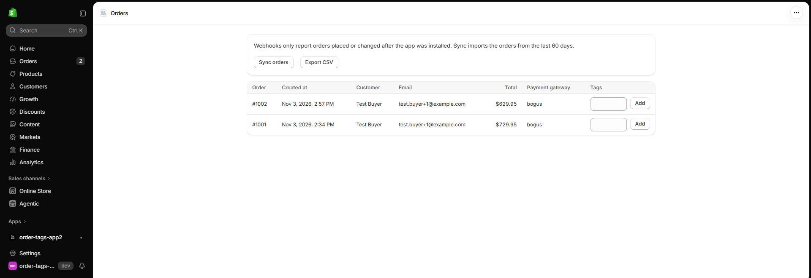
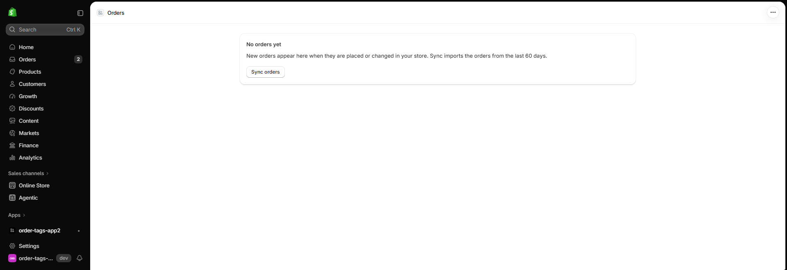
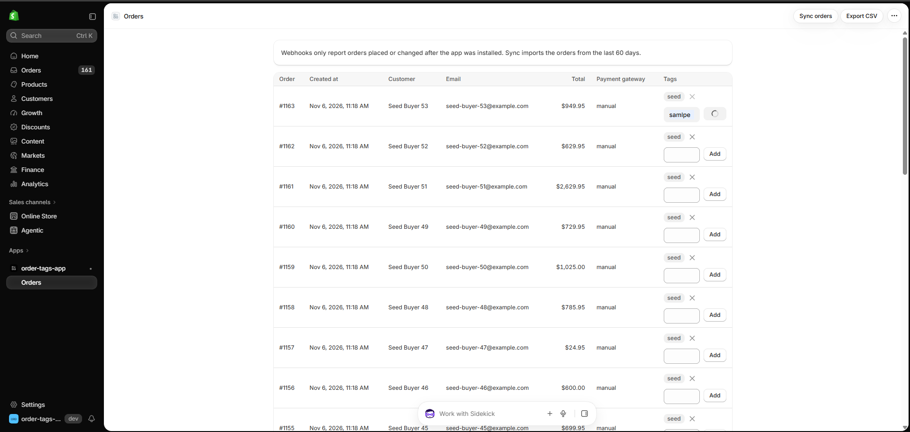
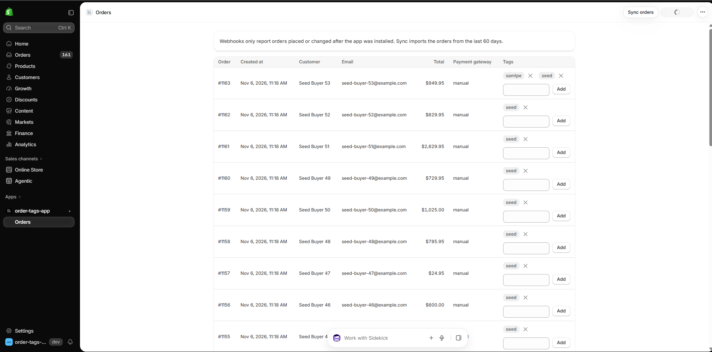
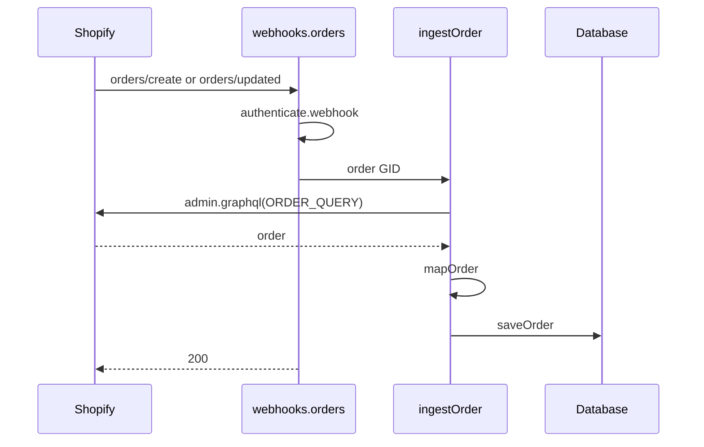
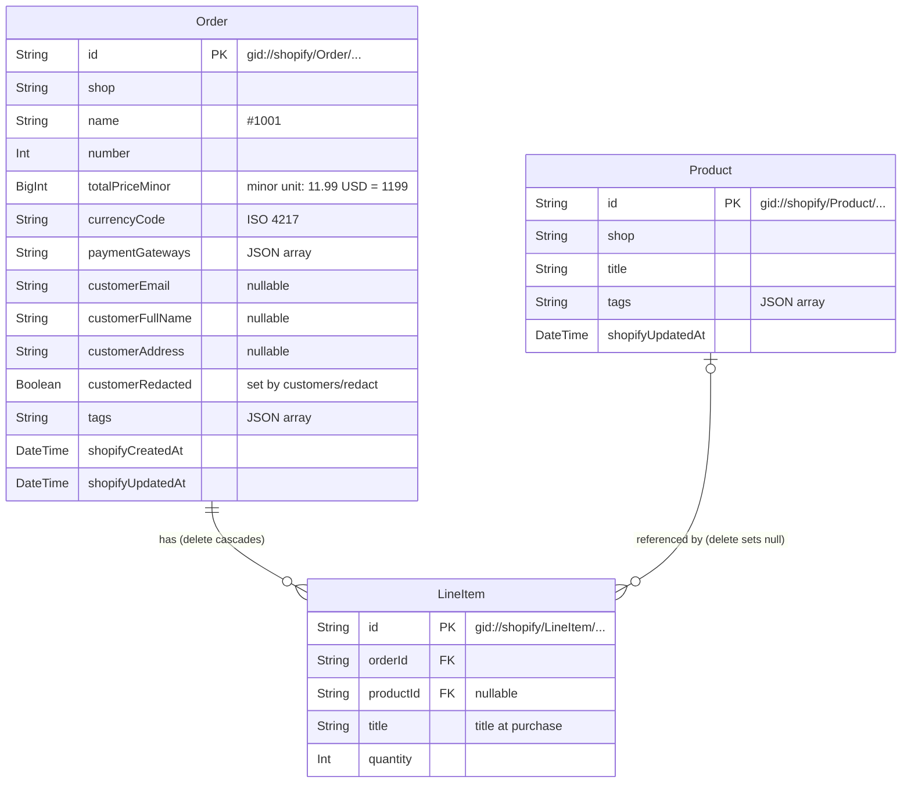

# Shopify Order Tags

## Overview

A Shopify app that captures orders through webhooks, lets merchants add and remove order tags, and exports orders to CSV.

The app is embedded in the Shopify admin. Its home page is the order list.
Orders are kept as copies of Shopify's data, and tag edits are written to Shopify first, so Shopify remains the owner of the data.

**Scope.** The app is built for this task: it runs on one development store with `npm run dev`, for one reviewer, and needs no other service. It chooses a setup that is simple to run (SQLite, webhooks processed within the request) over production scale. The limits were measured: one webhook takes about 0.5 s against Shopify's 5-second limit, and 39 webhooks sent within 8 seconds (10 orders created at once, then tagged at once) were all stored on the first attempt ([measurements](docs/adr/0005-process-webhooks-synchronously.md)). What production would need is listed under [Known limitations](#known-limitations--production-considerations).

## Features

| What the task asks for | What the app does |
|---|---|
| Create/update orders from store webhooks | When an order is created or updated in the store, a webhook keeps a copy of the order, its line items and their products in the app's database. **Sync orders** imports orders from the last 60 days that are not stored yet or have changed |
| Display a list of orders in a user-friendly interface | Orders newest first, 50 per page, with number, date, customer, email, total, payment gateway and tags |
| Add a tag to an order | Merchants add a tag from the order's row. Tags are written to Shopify, so they also appear in the Shopify admin |
| Remove a tag from an order | Merchants remove one with the button next to it |
| Export orders to a CSV file | **Export CSV** downloads all of the shop's orders, one row per line item, including each product's title and tags. [A sample file](samples/orders.csv) shows the result |
| Include fields not in `order/id/.json`: Product title, Product tags | The CSV has each product's title and tags, which the order JSON does not |

- **Customer data:** the app handles Shopify's compliance webhooks (the privacy webhooks Shopify requires of every public app) and deletes a shop's data when the app is uninstalled (see [Customer data](docs/database.md#customer-data))

### Order list



### Empty state



### Tag editing



### CSV download



## Requirements

- Node.js **24.22.1** (`.nvmrc`)
- A Shopify Partner account with an organization ([partners.shopify.com](https://partners.shopify.com))
- A development store (created in step 4 below)

## Setup

The full steps, with the admin click paths and screenshots, are in [docs/setup.md](docs/setup.md).

1. Connect your own app: `nvm use && npm ci && npm run config:link`, then copy `[access_scopes]` and `[webhooks]` from `shopify.app.toml` into the new `shopify.app.{name}.toml`
2. Choose **Public distribution** for your app in the Partner Dashboard
3. Allow access to protected customer data (**Name**, **Email**, **Address**) in the Partner Dashboard
4. Run the app and install it on a development store: `npm run dev`. This also creates the database
5. Place a test order with the test payment gateway (card number `1`). The webhook stores it
6. Import existing orders with **Sync orders** on the app home
7. Run the tests: `npm test`

## Commands

| Command | What it does |
|---|---|
| `npm run dev` | Runs the app through Shopify CLI, and applies database migrations |
| `npm test` | Runs all tests once |
| `npm run typecheck` | Regenerates route and GraphQL types, then runs `tsc` |
| `npm run lint` | Runs ESLint |
| `npm run build` | Builds the app for production |
| `npm run config:link` | Creates or selects an app in your own organization |

## Tech stack

| Area | Choice | Why |
|---|---|---|
| Framework | React Router 7 | Remix's successor and Shopify's current app template ([Why the app is built on the React Router template](docs/adr/0001-react-router-template.md)) |
| UI | Polaris web components | Polaris React receives no more updates ([Why the UI uses Polaris web components](docs/adr/0002-polaris-web-components.md)) |
| Database | Prisma + SQLite | No database server to set up. See [Database](#database) |
| Shopify API | Admin GraphQL API 2026-10 | Webhooks only trigger a re-fetch, which reads the order again from the Admin API ([Why the app re-fetches each order](docs/adr/0003-refetch-order-via-graphql.md)) |
| Tests | Vitest | Developed test-first ([Why the work was done test-first](docs/adr/0006-tdd.md)) |

There are few runtime dependencies because the app adds no library for CSV or queues: the CSV writer is a pure function, and webhooks are processed within the request ([Why webhooks are processed within the request](docs/adr/0005-process-webhooks-synchronously.md)).

## Directory structure

```text
app/
  components/         presentational UI
  lib/
    domain/           pure functions: mapping, money, tag rules, CSV
    repositories/     database reads and writes
    shopify/          GraphQL queries and mutations
    *.server.ts       services: ingest an order, sync orders, edit tags
  routes/             loaders, actions and webhook routes
prisma/               schema and migrations
samples/              sample CSV export
test/                 tests by layer, helpers, captured API responses
docs/                 details, decision records, requirements, images
```

## Design

### Data flow

An order webhook is only a trigger. It carries the order's GID (Shopify's global ID, `gid://shopify/Order/…`). The route re-fetches the whole order through GraphQL with that ID, and writes it before it responds ([Why the app re-fetches each order](docs/adr/0003-refetch-order-via-graphql.md), [Why webhooks are processed within the request](docs/adr/0005-process-webhooks-synchronously.md)).



A failed fetch does not return 2xx, so Shopify retries the delivery. **Sync orders** uses the same path: `syncOrders` lists orders with `ORDER_IDS_QUERY`, compares them with `findStoredUpdatedAt`, and calls `ingestOrder` for each new or changed order. `saveOrder` does not write over a newer stored copy.

### Layers

| Layer | Path | Rule |
|---|---|---|
| Routes | `app/routes/` | Authenticate the request, then call a service or a repository |
| Services | `app/lib/*.server.ts` | Order the Shopify calls and the database writes |
| Shopify | `app/lib/shopify/` | GraphQL documents, typed by `graphql-codegen` |
| Domain | `app/lib/domain/` | Pure functions, with no I/O |
| Repositories | `app/lib/repositories/` | The only code that reads or writes orders |
| UI | `app/components/` | Presentational |

One deliberate trade-off: `domain/order-list-row.ts` and `domain/orders-csv.ts` hold Prisma types and `select` definitions, so the domain layer knows about persistence. This ties the columns read from the database to the columns sent to the browser (without `customerAddress`) in one typed place.

### Database



- **Shopify GIDs are the primary keys.** A repeated webhook hits the same row, so it creates no duplicate, and no mapping between an app ID and a Shopify ID is needed
- **`Product` is a separate table.** A product is shared by many line items, and the CSV needs the product's own title and tags. `LineItem.title` keeps the title at purchase as the fallback
- **The order total is an integer in the currency's minor unit**, because a String cannot be summed and a Prisma `Decimal` on SQLite is a floating-point REAL
- **Tags and payment gateways are JSON arrays in String columns**, because SQLite has no array type

The tables, delete behaviour, indexes and the reasoning are in [docs/database.md](docs/database.md).

### Tags

Adding or removing a tag writes to Shopify first, with `tagsAdd` or `tagsRemove` ([Why tags are written to Shopify first](docs/adr/0004-sync-tags-to-shopify.md)). The app then re-fetches the order and stores it whole, the same way as a webhook. The checks on the input are in [Order tags](docs/interpretation.md#order-tags).

### CSV

| Item | Format |
|---|---|
| Columns | The nine fields of the CSV template, in order, followed by *Product title* and *Product tags* |
| Order id | The numeric ID, e.g. `6663058751643` from `gid://shopify/Order/6663058751643`. It is the `id` in `order/id.json` and in the Shopify admin's order URL |
| Order number | The number without the shop's prefix, e.g. `1006` for `#1006` |
| Total price | A plain decimal in the shop's currency, without a symbol: `11.99`, `1500` (JPY), `1.234` (KWD) |
| Multiple values in one cell (tags, payment gateways) | Joined with `, ` and quoted |
| Dates | ISO 8601 in UTC, e.g. `2026-11-02T13:05:00Z`. The shop's time zone is not stored, and UTC does not depend on the server's |
| Encoding | UTF-8 with a BOM, so Excel opens non-ASCII names and addresses correctly |
| Line endings | CRLF (RFC 4180) |
| Escaping | RFC 4180 (values containing `,`, `"` or line breaks are quoted; `"` is doubled). Values containing `;` are quoted too, for a reader that accepts both `,` and `;` as separators |
| Formula cells | A text cell (payment gateway, customer fields, tags, product title, product tags) starting with `=`, `+`, `-`, `@`, tab, carriage return, line feed or a full-width `＝`, `＋`, `－`, `＠` gets a leading `'`, because a spreadsheet can run such a cell as a formula ([OWASP](https://owasp.org/www-community/attacks/CSV_Injection)). The same characters also get a `'` when they follow `;` or a line break inside the cell, with or without a `"` in between (`x;=1+1` becomes `x;'=1+1`). Where `;` is the spreadsheet's separator, commas do not split a line, so a value is cut at each `;` and line break, and quoting does not prevent it. A merchant with a comma separator sees that `'` in the value. Numeric and generated columns (order id, order number, total price, created at) never do, so a negative total stays a number |

How the file is downloaded and what the sample shows are in [CSV format](docs/interpretation.md#csv-format).

### Security and customer data

| Concern | What the app does |
|---|---|
| Webhook signature | `authenticate.webhook` verifies the HMAC, and an invalid signature returns 401 |
| Shop in a webhook | The shop header is not signed, so `app/uninstalled` and the two redaction routes return 401 when the signed payload names another shop |
| Merchant requests | `authenticate.admin` verifies the session token, and orders are read for the session's shop only |
| Customer data stored | Name, email and address on `Order` only. The Shopify customer ID is not stored |
| `customers/redact` | Empties those fields on the listed orders, and keeps them empty on later ingestions |
| `app/uninstalled`, `shop/redact` | Delete the shop's orders, line items and products. `shop/redact` deletes nothing if the shop has a session again |
| `customers/data_request` | Logs the topic and shop only |

The details are in [Customer data](docs/database.md#customer-data). What is not covered, such as encryption at rest, is under [Known limitations](#known-limitations--production-considerations).

## Interpretation of the task

The task leaves some details open. The reasoning is in [docs/interpretation.md](docs/interpretation.md).

| Question | Choice |
|---|---|
| What is a CSV row? | One line item. Order columns repeat, and a line item with quantity `0` has no row |
| Product title | The product's own title, falling back to the title at purchase |
| Product tags | As fetched with an order containing the product, and stored once per product |
| Customer address | Shipping address, falling back to billing |
| Customer name and email | The order's customer and the email on the order. Both can be empty |
| Total price and quantity | Current values, after refunds and edits, in the shop's currency |
| CSV format | See [CSV](#csv) |
| Distribution | Public, not listed on the Shopify App Store |
| Order list columns | Order number, created at, customer, email, total, payment gateway, tags |
| Which tags are accepted? | Trimmed. Empty, over 55 characters, with a comma, or already on the order are rejected |

## Tests

The tests need no Partner account, store or `.env` file, and the work was done test-first ([Why the work was done test-first](docs/adr/0006-tdd.md)).

Test names start with the requirement ID, BE-1 to BE-6, listed in [docs/requirements.md](docs/requirements.md). The full format is `BE-{n} {Feature} : {spec}. {test case}` ([Test naming](docs/requirements.md#test-naming)).

```bash
npm test                              # all tests once
npx vitest run -t "BE-3 Add tag"      # the tests of one requirement
```

| Layer | What is tested |
|---|---|
| Domain | Inputs and outputs, with no mocks |
| Repositories | Real reads and writes against a test SQLite database |
| Routes | Loaders, actions and signed webhooks. Only `admin.graphql` is replaced, using captured responses |
| UI | What is rendered, with thin jsdom tests |

Configuration and the real store are checked by hand: [placing a test order](docs/setup.md#5-place-a-test-order), [importing existing orders](docs/setup.md#6-import-existing-orders) and [sending sample compliance webhooks](docs/database.md#customer-data).

## Where to find each requirement

Each requirement of the task, with its ID, the code that implements it, its tests and the decisions behind it. The test files listed are the main ones: searching `test/` for the name prefix finds the rest.

| Requirement | Implementation | Tests | Decisions |
|---|---|---|---|
| BE-1 Create/update orders from store webhooks | `app/routes/webhooks.orders.tsx`, `app/routes/app.sync.tsx`, `app/lib/ingest-order.server.ts` | `BE-1 Webhook ingestion`: `test/routes/webhooks.orders.test.ts`, `test/routes/app.sync.test.ts` | [Why the app re-fetches each order](docs/adr/0003-refetch-order-via-graphql.md), [Why webhooks are processed within the request](docs/adr/0005-process-webhooks-synchronously.md) |
| BE-2 Display a list of orders in a user-friendly interface | `app/routes/app._index.tsx`, `app/components/order-table.tsx` | `BE-2 Order list`: `test/routes/app._index.test.ts` | [Why the UI uses Polaris web components](docs/adr/0002-polaris-web-components.md), [Order list columns](docs/interpretation.md#order-list-columns) |
| BE-3 Add a tag to an order | `app/routes/app.tags.tsx`, `app/lib/tag-order.server.ts` | `BE-3 Add tag`: `test/routes/app.tags.test.ts` | [Why tags are written to Shopify first](docs/adr/0004-sync-tags-to-shopify.md), [Order tags](docs/interpretation.md#order-tags) |
| BE-4 Remove a tag from an order | `app/routes/app.tags.tsx`, `app/lib/tag-order.server.ts` | `BE-4 Remove tag`: `test/routes/app.tags.test.ts` | [Why tags are written to Shopify first](docs/adr/0004-sync-tags-to-shopify.md), [Order tags](docs/interpretation.md#order-tags) |
| BE-5 Export orders to a CSV file | `app/routes/app.export.tsx`, `app/lib/domain/orders-csv.ts` | `BE-5 CSV export`: `test/domain/orders-csv.test.ts` | [CSV](#csv) |
| BE-6 Include fields not in `order/id/.json`: Product title, Product tags | `app/lib/shopify/order-query.ts`, `app/lib/domain/order-mapper.ts` | `BE-6 Fields not in order JSON`: `test/repositories/order-repository.test.ts` | [Why the app re-fetches each order](docs/adr/0003-refetch-order-via-graphql.md), [Product title](docs/interpretation.md#product-title-the-products-own-title-falling-back-to-the-title-at-purchase) |

## Known limitations / Production considerations

These follow from the scope in the [Overview](#overview). The main items are below. The full list, with the reasoning, the related issues and the dependency audit, is in [docs/known-limitations.md](docs/known-limitations.md).

### Scope decisions

- Webhooks are processed within the request over one SQLite connection. Production would use a queue and a database with concurrent writes
- Only the first 250 line items of an order are stored (one page of the GraphQL query). Line items beyond that are not stored and not in the CSV
- Access tokens and customer data are not encrypted at rest
- `customers/data_request` only logs the request
- There is no CI, and no deployment configuration

### Known issues

- An `app/uninstalled` delivery fails when the shop's offline token (the access token the app uses when no merchant is present) has expired, so the shop's data is not deleted
- A signed `app/uninstalled` delivery can be sent again after a reinstall, and a late retry can do the same, deleting the new install's data
- A webhook's fetch in the same second as a tag edit can undo the edit in the stored copy

## Development process

Requirements, their issues and the test naming are in [docs/requirements.md](docs/requirements.md). The rules are in three documents:

- **Issue-first TDD ([CONTRIBUTING.md](CONTRIBUTING.md)):** a change starts from an issue with a test list. It is built test-first on its own branch and reaches `main` through a pull request that records what was run, the risks and how to roll back
- **Code review ([REVIEW.md](REVIEW.md)):** a pull request is reviewed by an agent that did not write the code, with one fix-and-verify round. Merging is the author's decision
- **Security review ([SECURITY_REVIEW.md](SECURITY_REVIEW.md)):** required when a pull request touches authentication, webhooks, customer data, Shopify writes, scopes, exports or dependencies

### Reading the commit history

Pull requests are merged with merge commits, and squash and rebase merges are disabled, so the commits of each change stay in the history.

```bash
git log --first-parent --oneline main                       # one merge per pull request, after the first setup commits
git log --no-merges --oneline --reverse --grep='(#3)' main  # the commits of one issue, oldest first
```

Within an issue, a `test:` commit adds a failing test, a `feat:` or `fix:` commit makes it pass, and a `refactor:` commit cleans up. Each message ends with its issue number. Tests can fail at commits inside a branch, so only the merge commits on `main` are expected to pass.
Known exceptions are listed in [PR #90](https://github.com/rukiita/shopify_test/pull/90) under "Commit history". The setup commits before the first pull request, and the `test:` commits of #90 itself, which state existing behaviour, are also outside this pattern.

## Documents

The README alone is enough to evaluate the work. These files hold the detail.

| File | Content |
|---|---|
| [docs/setup.md](docs/setup.md) | Full installation and configuration steps |
| [docs/database.md](docs/database.md) | Tables, design choices, delete behaviour, customer data |
| [docs/interpretation.md](docs/interpretation.md) | The reasoning behind each reading of the task |
| [docs/known-limitations.md](docs/known-limitations.md) | All limitations, and the dependency audit |
| [docs/adr/](docs/adr/README.md) | Architecture Decision Records (ADRs): the design decisions linked throughout this README, each with its options and reasoning, and a table summarizing them |
| [docs/requirements.md](docs/requirements.md) | Requirements, their issues, and the test naming |
