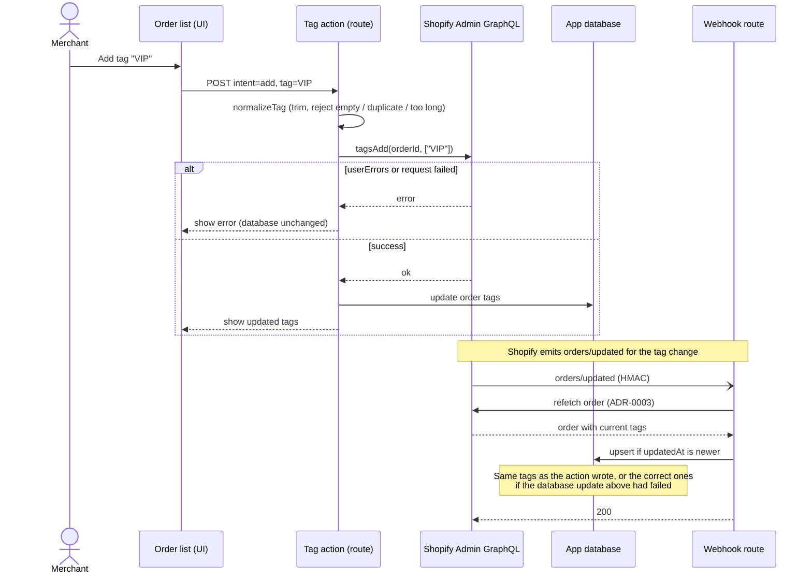

# 0004. Write order tags to Shopify as the single source of truth

- Status: Accepted
- Date: 2026-10-30
- Issue: #16 (DEC-4)

## Context

The task asks that merchants can add and remove tags on orders from the app, but does not say whether those tags should also be written to the Shopify order.
The app overwrites orders when `orders/updated` arrives (BE-1), so some ways of storing tags conflict with that overwrite.

## Options considered

1. Write to Shopify with `tagsAdd` / `tagsRemove`, and update the database too
2. Keep an app-specific tag table, separate from Shopify's tags
3. Update only the `tags` column in the app database

## Decision

Option 1. Shopify owns the data; the app database is a copy of it.
Option 3 does not work: the next `orders/updated` would revert the tags to Shopify's values.
Option 2 works, but it makes "Tags" in the CSV ambiguous, and the tags would not match what the merchant sees in the Shopify admin.

How the write is done:

- **`tagsAdd` / `tagsRemove`, not `orderUpdate`.** `orderUpdate` replaces the whole tag list, so a tag
  the merchant added in the Shopify admin at the same moment could be lost. `tagsAdd` / `tagsRemove`
  only touch the given tags.
- **Shopify first, then the database.** The database is updated only after Shopify accepts the write,
  so the UI reflects the change without waiting for the webhook. If Shopify returns `userErrors`
  or fails, the database is left unchanged and the error is shown.
- **Self-healing.** If the Shopify write succeeds but the database update fails, the following
  `orders/updated` refetches the order (ADR-0003) and stores the correct tags.

## Flow

## Consequences

- Positive: no conflict with webhooks by construction. Tags match between the app and the Shopify admin. A failed database update repairs itself on the next webhook
- Negative: requires the `write_orders` scope, so merchants grant write access at install. Each tag operation is an API call
- Revisit when: internal tags that should not appear in Shopify become necessary (add option 2 alongside)

## References

- https://shopify.dev/docs/api/admin-graphql/latest/mutations/tagsAdd
- https://shopify.dev/docs/api/admin-graphql/latest/mutations/tagsRemove
