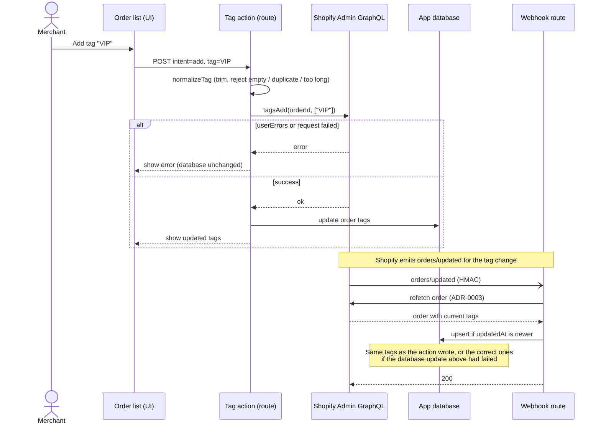

# 0004. Write order tags to Shopify as the single source of truth

- Status: Accepted
- Date: 2026-10-30
- Issue: #16 (DEC-4)

## Context

The task asks that merchants can add and remove tags on orders from the app, but does not say whether those tags should also be written to the Shopify order.

Background that drives this decision:

- **Shopify holds the original order.** Orders are created by Shopify's checkout and stored in Shopify. Merchants, staff and other apps change them through the Shopify admin or the Admin API. This app is a third-party app outside Shopify; it never owns an order.
- **The app database is a copy.** The task requires storing orders in the app database, and the copy lets the order list and CSV export run without calling the API every time.
- **The copy is rebuilt on every change.** `orders/updated` fires for any change to an order (fulfillment, payment capture, refund, note, address, tags). On each one the app refetches the order and overwrites the stored copy with Shopify's current state, tags included (ADR-0003).

So anything written only to the copy is lost the next time the copy is rebuilt.

## Options considered

1. Write to Shopify with `tagsAdd` / `tagsRemove`, and update the database too
2. Keep an app-specific tag table, separate from Shopify's tags
3. Update only the `tags` column in the app database

## Decision

Option 1. Shopify owns the data; the app database is a copy of it.

**Option 3 does not work.** A tag written only to the database disappears on the next unrelated change to the order:

```
10:00  Add "VIP" in the app      app DB: [VIP]   Shopify: []
13:00  Staff fulfills the order  → orders/updated
13:00  Refetch and overwrite     app DB: []      (VIP is gone)
```

Skipping `tags` when overwriting would keep "VIP", but then tags added or removed in the Shopify admin would never reach the app, and the two would drift apart. That is option 2 in disguise.

**Option 2 works, but has no good answers to the questions it raises.** With "wholesale" added in the Shopify admin and "VIP" added in the app:

- Which tags does the order list show? Only the app's hides Shopify's; both raises the next question
- Can the app remove "wholesale"? If yes, it must write to Shopify, which is option 1 anyway. If no, some tags have a remove button and some do not
- Which tags go into the CSV "Tags" column? Either choice drops one set; mixing them loses which is which
- "VIP" is invisible to Shopify, so it cannot be used to filter orders in the Shopify admin or in Shopify Flow, which is what order tags are for

"Tag an order" is most naturally read as Shopify's own order tags, so option 1 is chosen.

How the write is done:

- **`tagsAdd` / `tagsRemove`, not `orderUpdate`.** `orderUpdate` replaces the whole tag list, so a tag
  the merchant added in the Shopify admin at the same moment could be lost. `tagsAdd` / `tagsRemove`
  only touch the given tags.
- **Shopify first, then the database.** The database is updated only after Shopify accepts the write,
  so the UI reflects the change without waiting for the webhook. If Shopify returns `userErrors`
  or fails, the database is left unchanged and the error is shown.
- **Self-healing.** If the Shopify write succeeds but the database update fails, the following
  `orders/updated` refetches the order (ADR-0003) and stores the correct tags.

## Flow

Where each participant runs:

| Participant | Runs on | Role |
|---|---|---|
| Merchant, Order list (UI) | Browser, inside the Shopify admin | Sends the tag form |
| Tag action (route) | App server | The route's `action` function: validates the tag and calls Shopify |
| Shopify Admin GraphQL | Shopify | The API through which apps read and write the original order (`admin.graphql(...)`) |
| App database | App server | The copy of orders used for the list and CSV |
| Webhook route | App server | Receives `orders/updated` and refreshes the copy (ADR-0003) |



## Consequences

- Positive: no conflict with webhooks by construction. Tags match between the app and the Shopify admin. A failed database update repairs itself on the next webhook
- Negative: requires the `write_orders` scope, so merchants grant write access at install. Each tag operation is an API call
- Revisit when: internal tags that should not appear in Shopify become necessary (add option 2 alongside)

## References

- https://shopify.dev/docs/api/admin-graphql/latest/mutations/tagsAdd
- https://shopify.dev/docs/api/admin-graphql/latest/mutations/tagsRemove
