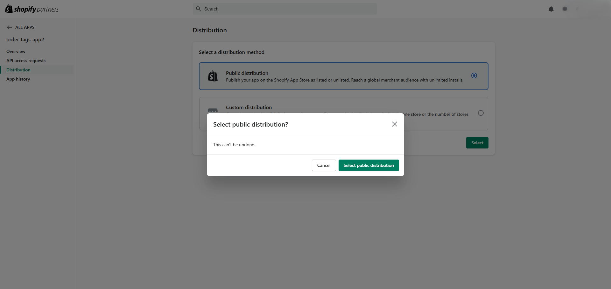
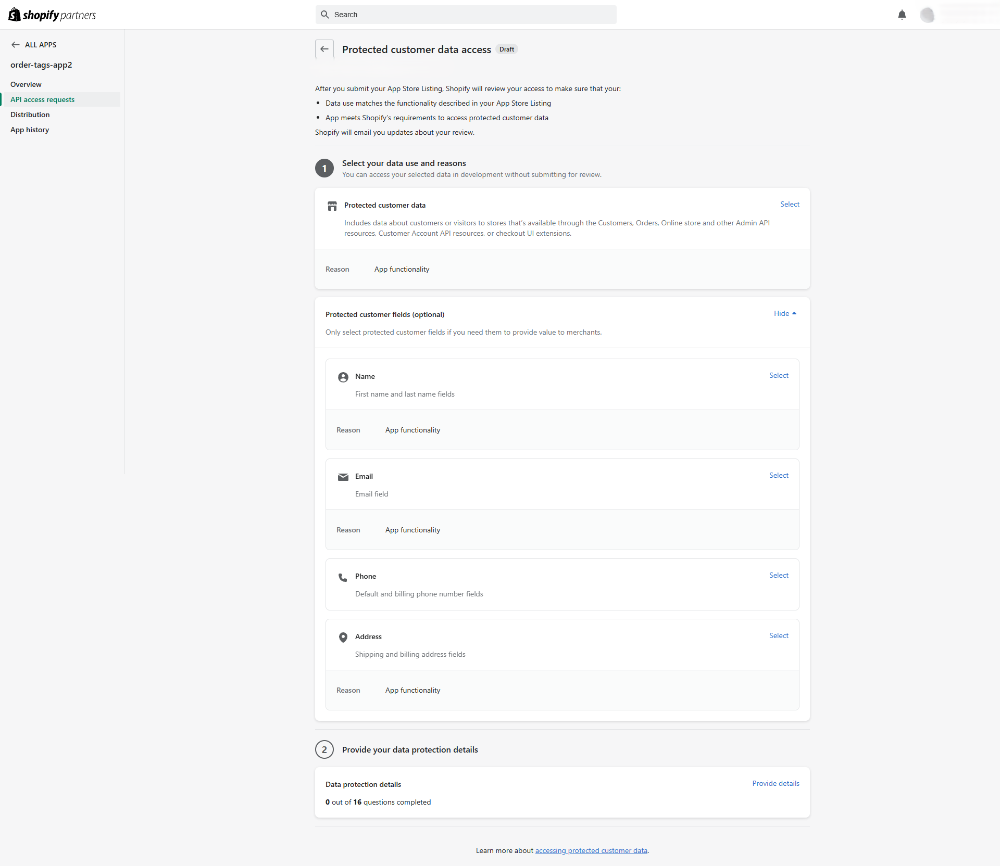

# インストールと設定

[English](setup.md) | 日本語

> これは [setup.md](setup.md) の翻訳です。内容が異なる場合は英語版を優先してください。

インストールと設定の全手順です。短い版は [README](../README.ja.md#セットアップ) にあります。

Shopify 管理画面のラベルは、英語の表示のまま記載しています。画面が変わっている場合は、リンク先の Shopify のドキュメントに現在の手順があります。

## 前提条件

- Node.js **24.22.1**(`.nvmrc` で固定。nvm を使う場合は `nvm use` を実行します)。アプリは `package.json` で `>=22.12` も宣言しており、`.npmrc` により `npm` はそれより古いバージョンを拒否しますが、ビルドとテストに使ったバージョンは 24.22.1 です
- 組織のある Shopify Partner アカウント([partners.shopify.com](https://partners.shopify.com))。組織がないと、Shopify CLI は "No Organization found" で停止します

Shopify CLI はプロジェクトの依存関係(`dependencies` の `@shopify/cli`)なので、グローバルインストールは不要です。npm スクリプトまたは `npx shopify` で実行します。

## 1. 依存関係をインストールして自分のアプリに接続する

```bash
nvm use               # Node.js version from .nvmrc
npm ci                # install exactly the versions in package-lock.json
npm run config:link   # create or select an app in your own organization
```

`shopify.app.toml` には作者の `client_id` が入っています。このファイルが存在するので、`config:link` は設定名を尋ね、自分のアプリ用に `shopify.app.{name}.toml` を作成します。これが `npm run dev` のデフォルトになります。[Manage app config files](https://shopify.dev/docs/apps/build/cli-for-apps/manage-app-config-files) を参照してください。

新しいファイルの内容は Shopify 上の自分のアプリから取り込まれるので、このアプリに必要なものがすべて揃うわけではありません。新規作成したアプリの場合、スコープはありますが、Webhook のサブスクリプションはなく、`api_version` も異なります。`shopify.app.toml` の `[access_scopes]` と `[webhooks]` のセクションをコピーし、既にあるものと置き換えてください。

## 2. 配布方法を選ぶ

Dev Dashboard で自分のアプリを開き、その Home で **Distribution** カードを使います。Partner Dashboard にあるアプリの **Distribution** ページが開きます。**Public distribution** を選び、**Select** をクリックしてから、**Select public distribution** で確定します。保護された顧客データをリクエストするには、Shopify は配布方法の選択を必須としています。[Select a distribution method](https://shopify.dev/docs/apps/launch/distribution/select-distribution-method) を参照してください。

この選択は後から変更できません。Shopify のドキュメントには、公開配布には Shopify App Store への登録も必要で、1 回限りの料金がかかると書かれています([About app distribution](https://shopify.dev/docs/apps/launch/distribution))。このアプリは掲載を必要とせず、料金を支払ったことのないアカウントで、公開配布の選択でも開発ストアでのアプリ実行でも、登録や料金を求められませんでした(#91)。



## 3. 保護された顧客データへのアクセスを許可する

注文の Webhook と CSV エクスポートには、顧客の氏名、メールアドレス、住所が必要です。[Work with protected customer data](https://shopify.dev/docs/apps/launch/protected-customer-data) を参照してください。

1. **Partner Dashboard**(Dev Dashboard ではありません)で **Apps** に移動し、Dev Dashboard のアプリの一覧から自分のアプリを開いて、**API access requests** → **Protected customer data access** に進みます
2. **Protected customer data** と、フィールド **Name**、**Email**、**Address** を選び、理由に "App functionality" を選びます
3. 保存します。ステップ 2(データ保護の詳細)は App Store の審査でのみ必要で、開発ストアでは不要です



## 4. 開発ストアでアプリを実行する

```bash
npm run dev
```

尋ねられたら、新しい開発ストアを作成します(どのプランでも動きますが、**Basic** を推奨します。**demo data** を使うと、最初から商品と注文が揃います)。その後、プレビュー URL を開いてアプリをインストールします。[Scaffold an app](https://shopify.dev/docs/apps/build/scaffold-app)(ステップ 3 と 4)と [Test apps locally](https://shopify.dev/docs/apps/build/cli-for-apps/test-apps-locally) を参照してください。

`npm run dev` は、ステップ 1 でコピーしたセクションのスコープ(`read_customers`、`read_orders`、`read_products`、`write_orders`)と Webhook のサブスクリプションを適用します。ほかの設定は不要です。

`npm run dev` の実行中は、dev プレビューがストアのアプリを自分のマシンに向けます。アプリをアンインストールすると、プレビューは削除されます。再度インストールするには、Dev Dashboard の自分のアプリの **Installs** カードにある **Install app** を使い、`npm run dev` を再起動します。再起動しないと、アプリはプレースホルダーの `https://example.com` を開きます。

データベースの準備も不要です。`npm run dev` は `prisma generate` と `prisma migrate deploy` を実行し(`shopify.web.toml`)、初回の実行で `prisma/dev.sqlite` を作成して、以後は新しいマイグレーションを適用します。`.env` ファイルは不要です。

## 5. テスト注文を作成する

**demo data** で作成したストアでは、Shopify のテスト用決済ゲートウェイが有効になっています([Generated test data](https://shopify.dev/docs/apps/build/stores/generated-test-data)。ここでは Bogus payment gateway と呼ばれています)。これで支払った注文のゲートウェイは `bogus` と表示されます。チェックアウトに表示されない場合は、**Settings** → **Payments** で有効にします([Shopify's Test payment gateway](https://help.shopify.com/en/manual/checkout-settings/test-orders/payments-test-mode))。

1. Shopify 管理画面からオンラインストアを開きます(**Sales channels** → **Online Store** → 目のアイコン)。ストアフロントのパスワードは **Online Store** → **Preferences** にあります([Dev stores](https://shopify.dev/docs/storefronts/themes/tools/development-stores))
2. 商品をカートに入れ、テストデータでチェックアウトします。たとえばメールアドレスは `test.buyer+1@example.com`、住所は米国のものを使います
3. カード番号 `1`、未来の任意の有効期限、任意の 3 桁のセキュリティコード、カード名義 `Test payment gateway` で支払います

`npm run dev` の実行中は `orders/create` Webhook が注文を保存し、ページを再読み込みするとアプリのホームの注文一覧に表示されます。Shopify 管理画面で注文を編集する(たとえばタグを追加する)と `orders/updated` が送信され、保存済みのコピーが更新されます。保存された行を見るには、`npx prisma studio` で開発用データベースを開きます(テーブル `Order`、`LineItem`、`Product`)。

### 53 件のテスト注文をまとめて追加する

注文一覧は 1 ページに 50 件の注文を表示します。注文を手作業で作成せずに 2 ページ目を確認できるよう、スクリプトがストアに 53 件の注文を作成します。スクリプトはアプリではなく Shopify CLI 自身のストアへのアクセスを使うので、先に一度 CLI を認可します。ブラウザが開き、スコープの承認を求められます。

```bash
npx shopify store auth --store <your-store>.myshopify.com --scopes read_products,write_draft_orders,read_orders
npm run seed:orders -- --store <your-store>.myshopify.com
```

`<your-store>` は、ステップ 4 の開発ストアです(管理画面の URL にある名前)。スクリプトは TypeScript のまま実行するので、Node.js 24(ステップ 1)が必要です。

- **作成されるもの:** 各注文は、下書き注文を支払い済みとして完了したもので、決済ゲートウェイは `bogus` ではなく `manual` になります。商品は 1 つで、ギフトカードを除く有効な商品を順に使います。顧客はテスト用で、`seed-buyer-1@example.com` から `seed-buyer-53@example.com` です。Shopify がメールアドレスと配送先住所の氏名から顧客を作成します。すべての注文に `seed` タグが付くので、Shopify 管理画面でこのタグから注文を探せます。
- **所要時間:** 開発ストアでは、53 件の注文が 76 秒で作成されました(最初の注文から最後の注文まで)。CLI の呼び出しごとに Shopify CLI の起動に時間の大半がかかるので、注文は 5 件ずつ同時に作成します。
- **注文がアプリに届く経路:** `npm run dev` の実行中は、`orders/create` Webhook が保存します。実行していない場合は、**Sync orders** でインポートします([ステップ 6](#6-既存の注文をインポートする))。
- **もう一度実行すると:** 53 件が追加されます。前回の実行の続きにはなりません。
- **途中で止まった場合:** 作成した注文の数とエラーが表示されます。エラーが認証に関するものなら、`shopify store auth` をもう一度実行してください。

## 6. 既存の注文をインポートする

Webhook が通知するのは、アプリのインストール後に作成または変更された注文だけです。それ以前の注文をインポートするには、アプリを開いてアプリのホームで **Sync orders** をクリックします。実行中はボタンが無効になり、完了するとインポートした注文の件数が表示されます。同期は注文を `updatedAt` とともに一覧し、未保存のものと保存後に変更があったものだけを取得します。それぞれ、Webhook と同じ再取得(Admin API から注文を読み直すこと)と書き込みを通ります([アプリが各注文を再取得する理由](adr/0003-refetch-order-via-graphql.md))。そのため、何も変わっていなければ、2 回目の同期でインポートされる注文は `0` 件です。同期が途中で止まった場合は、止まる前にインポートした件数がページに表示され、再度実行するとそこから続行します。

このアプリは `read_all_orders` なしで `read_orders` を持つので、Admin API が一覧するのは過去 60 日間に作成された注文だけで([access scopes](https://shopify.dev/docs/api/usage/access-scopes))、同期もそれらだけをインポートします。Partner 組織で作成したアプリが `read_all_orders` を持つには、Shopify の承認が必要です。

## 7. テストを実行する

```bash
npm test             # all tests once
npm run test:watch   # re-run on change
npm run typecheck    # regenerates GraphQL types, then runs tsc
```

テストに Partner アカウント、ストア、`.env` ファイルは不要です。実行のたびに、別のデータベース `prisma/test.sqlite` を `prisma/migrations/` から再構築するので、`prisma/dev.sqlite` には触れません。Shopify の Admin API は、開発ストアから取得したレスポンス(`test/fixtures/`)に置き換えます。各レイヤーのテスト方法の詳細は [CONTRIBUTING.md](../CONTRIBUTING.md#how-each-layer-is-tested) にあります(英語)。
