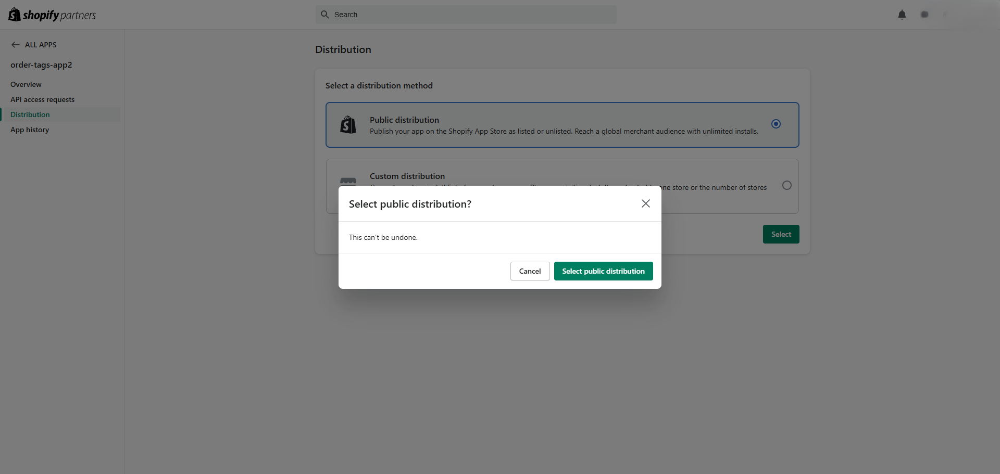
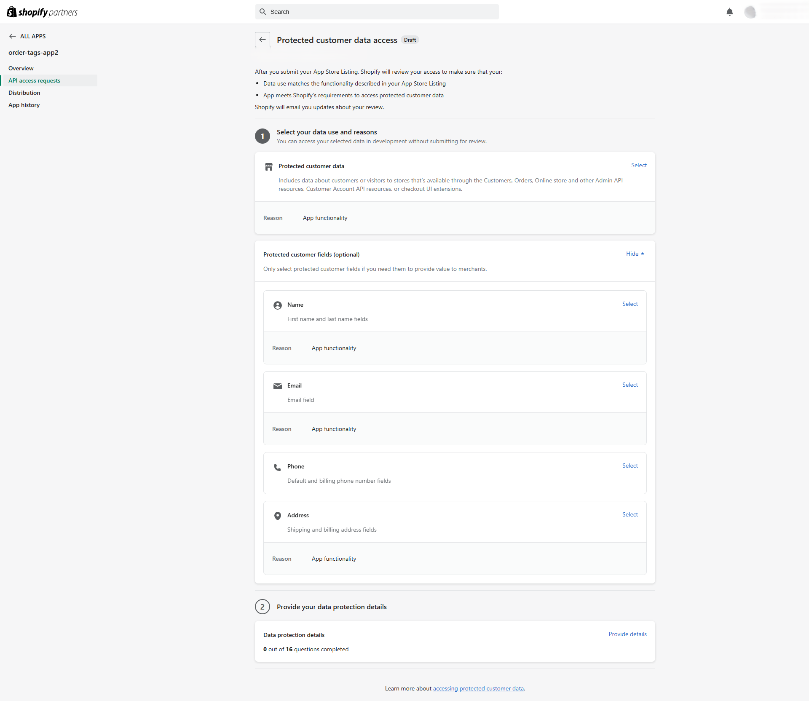

# Installation and configuration

The full installation and configuration steps. The [README](../README.md#setup) has the short version.

Shopify admin labels are given as they appear in English. If a screen has changed, the linked Shopify documentation has the current steps.

## Prerequisites

- Node.js **24.22.1** (pinned in `.nvmrc`; with nvm, run `nvm use`). The app also declares `>=22.12` in `package.json`, and `.npmrc` makes `npm` refuse older versions, but 24.22.1 is the version it was built and tested with
- A Shopify Partner account with an organization ([partners.shopify.com](https://partners.shopify.com)). Without an organization, Shopify CLI stops with "No Organization found"

Shopify CLI is a project dependency (`@shopify/cli` in `dependencies`), so no global install is needed. Run it through the npm scripts or `npx shopify`.

## 1. Install dependencies and connect your own app

```bash
nvm use               # Node.js version from .nvmrc
npm ci                # install exactly the versions in package-lock.json
npm run config:link   # create or select an app in your own organization
```

`shopify.app.toml` contains the author's `client_id`. Because that file exists, `config:link` asks for a configuration name and creates `shopify.app.{name}.toml` for your app, which becomes the default for `npm run dev`. See [Manage app config files](https://shopify.dev/docs/apps/build/cli-for-apps/manage-app-config-files).

The new file is filled from your app in Shopify, so it does not have everything this app needs. For a newly created app, it has the scopes, but no webhook subscriptions and a different `api_version`. Copy the `[access_scopes]` and `[webhooks]` sections from `shopify.app.toml` into it, replacing the ones already there.

## 2. Choose the distribution method

Open your app in the Dev Dashboard and, on its Home, use the **Distribution** card. It opens the app's **Distribution** page in the Partner Dashboard. Choose **Public distribution**, click **Select**, then confirm with **Select public distribution**. Shopify requires a distribution method before protected customer data can be requested. See [Select a distribution method](https://shopify.dev/docs/apps/launch/distribution/select-distribution-method).

The choice cannot be changed later. Shopify's documentation says that public distribution also requires registering for the Shopify App Store, which has a one-time fee ([About app distribution](https://shopify.dev/docs/apps/launch/distribution)). This app needs no listing, and neither selecting public distribution nor running the app on a development store asked for the registration or the fee, on an account that has never paid it (#91).



## 3. Allow access to protected customer data

Order webhooks and the CSV export need customer names, emails and addresses. See [Work with protected customer data](https://shopify.dev/docs/apps/launch/protected-customer-data).

1. In the **Partner Dashboard** (not the Dev Dashboard), go to **Apps**, open your app from the list of Dev Dashboard apps, then **API access requests** → **Protected customer data access**
2. Select **Protected customer data**, and the fields **Name**, **Email** and **Address**, with the reason "App functionality"
3. Save. Step 2 (data protection details) is only needed for App Store review, not for development stores



## 4. Run the app on a development store

```bash
npm run dev
```

When asked, create a new development store (any plan works; **Basic** is recommended, and **demo data** gives you products and orders to start with), then open the preview URL and install the app. See [Scaffold an app](https://shopify.dev/docs/apps/build/scaffold-app) (steps 3 and 4) and [Test apps locally](https://shopify.dev/docs/apps/build/cli-for-apps/test-apps-locally).

`npm run dev` applies the scopes (`read_customers`, `read_orders`, `read_products`, `write_orders`) and webhook subscriptions from the sections you copied in step 1; no other setup is needed.

While `npm run dev` runs, a dev preview points the store's app at your machine. Uninstalling the app removes the preview. To install it again, use **Install app** on the **Installs** card of your app in the Dev Dashboard, then restart `npm run dev`. Without the restart, the app opens the placeholder `https://example.com`.

The database needs no setup either. `npm run dev` runs `prisma generate` and `prisma migrate deploy` (`shopify.web.toml`), which create `prisma/dev.sqlite` on the first run and apply new migrations after that. No `.env` file is needed.

## 5. Place a test order

A store created with **demo data** has Shopify's test payment gateway enabled ([Generated test data](https://shopify.dev/docs/apps/build/stores/generated-test-data), which calls it the Bogus payment gateway). Orders paid with it list the gateway as `bogus`. If it is not offered at checkout, activate it under **Settings** → **Payments** ([Shopify's Test payment gateway](https://help.shopify.com/en/manual/checkout-settings/test-orders/payments-test-mode)).

1. Open the online store from the Shopify admin (**Sales channels** → **Online Store** → eye icon). The storefront password is under **Online Store** → **Preferences** ([Dev stores](https://shopify.dev/docs/storefronts/themes/tools/development-stores))
2. Add products to the cart and check out with test data, e.g. email `test.buyer+1@example.com`, a US address
3. Pay with card number `1`, any future expiry date, any 3-digit security code, and name on card `Test payment gateway`

The `orders/create` webhook stores the order while `npm run dev` is running, and it appears in the order list on the app home after you reload the page. Editing the order in the Shopify admin (for example, adding a tag) sends `orders/updated`, which updates the stored copy. To look at the stored rows, open the development database with `npx prisma studio` (tables `Order`, `LineItem`, `Product`).

## 6. Import existing orders

Webhooks only report orders placed or changed after the app was installed. To import the orders placed before that, open the app and click **Sync orders** on the app home. The button is disabled while the sync runs, and then shows how many orders were imported. The sync lists the orders with their `updatedAt` and fetches only those not stored yet or changed since they were stored; each of them goes through the same re-fetch (reading the order again from the Admin API) and write as a webhook ([Why the app re-fetches each order](adr/0003-refetch-order-via-graphql.md)). So a second sync imports `0` orders if nothing changed. If a sync stops partway, the page says how many orders were imported before it stopped, and running it again continues from there.

The app has `read_orders` without `read_all_orders`, so the Admin API lists only orders created in the last 60 days ([access scopes](https://shopify.dev/docs/api/usage/access-scopes)), and the sync imports only those. `read_all_orders` needs Shopify's approval for an app created under a Partner organization.

## 7. Run the tests

```bash
npm test             # all tests once
npm run test:watch   # re-run on change
npm run typecheck    # regenerates GraphQL types, then runs tsc
```

The tests need no Partner account, store or `.env` file. Each run rebuilds a separate database, `prisma/test.sqlite`, from `prisma/migrations/`, so `prisma/dev.sqlite` is not touched. Shopify's Admin API is replaced with responses captured from a development store (`test/fixtures/`). More on how each layer is tested is in [CONTRIBUTING.md](../CONTRIBUTING.md#how-each-layer-is-tested).
